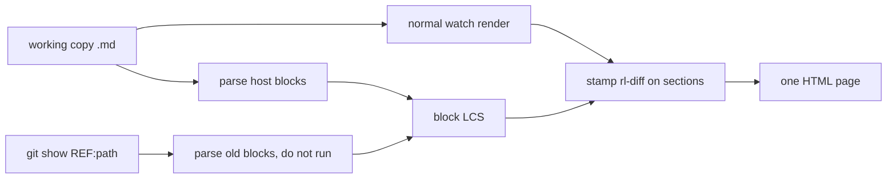

# Plan: git diff inside `notebook watch`

**Status:** design only — not started
**Current phase:** none (no implementation until this plan is accepted)
**Created:** 2026-10-14
**Issue:** [#66](https://github.com/kreegerresearch/rustlab/issues/66) (Michael)
**Surfaces:** interactive `rustlab-notebook watch` first. Static `render --diff` is a later phase.

This is a design document. It does not add code, routes, or dependencies.

## Goal

While `rustlab-notebook watch` is showing a notebook, compare that file with a git revision and see the deltas on the rendered page: which blocks were added, removed, or changed.

The working copy stays the page. Git is only a read of the "before" text. Nothing in this feature writes a file, a ref, or the index.

This is not tracked changes and not CriticMarkup. `dev/plans/notebook_comments.md` keeps review notes in the `.md` itself (`==` / `%%`). Those notes stay as they are. A git diff only *displays* what git already stores.

## Recommendation

One comparison, one view, no second execution.

| Choice | MVP |
|---|---|
| What is compared | The file on disk (after) against one git object (before). Default object: `HEAD`. |
| How you turn it on | `watch --diff` or `watch --diff <ref>`, the toolbar **Diff** button, or `?diff=<ref>`. |
| What you see | The rendered notebook, with a bar on added, removed, and changed blocks. Prev / next jumps between those blocks. |
| Code cells | Line diff of the cell source. The output and plots underneath are the working copy, labeled as such. The old cell is not run. |
| Prose | The whole block is marked. Word-level paint inside a paragraph waits. |
| Comments | Same as the page. Comments on: a new `%%` shows up as a changed block and its margin card. Comments off: both sides are stripped before alignment, so a comment-only edit stays quiet. |
| Where the old text comes from | `git show`, fixed argv, no shell, no new crate. |
| Who shares the ref | The whole watch process. One user, one ref. Same idea as one working copy per server. |

Side-by-side is not part of the plan. The page already has a file browser, a table of contents, and an 18rem comment column. A second rendered copy does not fit, and it would show two copies of every plot.

## Mockup

Toolbar when diff is on, directory watch, comments on. The file browser lists names only today (`file_browser.rs`); a dot is the only addition.

```
┌ topbar: filters.md          [ ↑ 2/5 ] [ ↓ ]  Diff [on]  vs [ HEAD____ ]   [ Source ]
├────────────┬───────────────────────────────────────────────────┬─────────────┐
│ Notebooks  │                                                   │ comments    │
│ ● filters  │  prose, unchanged                                │             │
│   intro    │                                                   │             │
│ ● bode     │ ┃ added                                         │             │
│            │ ┃ The passband is 0.25.                         │             │
│            │                                                   │             │
│            │ ┃ changed · output is the working copy          │  1 why?     │
│            │ ┃ ```rustlab                                    │             │
│            │ ┃ - h = fir_lowpass(31, ...)                    │             │
│            │ ┃ + h = fir_lowpass(63, ...)                    │             │
│            │ ┃ plot(h)          ← current figure only        │             │
│            │                                                   │             │
│            │ ┃ removed                                       │             │
│            │ ┃ ## Old heading                                │             │
│            │ ┃ (old prose, not executed)                     │             │
└────────────┴───────────────────────────────────────────────────┴─────────────┘
```

`●` is a changed notebook. The bar is a 4px stripe plus a wash behind the block. Body text stays the theme text color. Green and red are the stripe and the wash, not the letters.



## 1. User experience

### 1.1 Turning it on

All three do the same thing. The server stores one `DiffRef` on `ServerState`.

| Entry | Effect |
|---|---|
| `rustlab-notebook watch path` | Unchanged. No git calls. |
| `watch path --diff` | Diff on, ref `HEAD`. |
| `watch path --diff <ref>` | Diff on, that ref. |
| `watch path --diff index` | Diff on, the index (`git show :path`). |
| Toolbar **Diff** | Toggles. Off returns the page to today's render. |
| Ref field | Replaces the ref and re-renders. |
| `GET /n/<slug>?diff=<ref>` | Sets the server ref, then serves the page. |
| `GET /n/<slug>` with no query | Uses whatever the server already has, including "off". |

The ref field and `?diff=` accept `HEAD`, `HEAD~3`, `origin/main`, a hex sha, or the token `index`. They do not accept a range. `main..HEAD` is rejected with "one ref; the page is the working copy."

`--diff` on the non-interactive watcher (`--obsidian` or `--output`, `watch.rs`) is ignored with the same kind of warning `--editable` already prints. Diff mode is the interactive server only.

### 1.2 The view

Inline, on the rendered page, inside `<main>`.

| Alignment | What the page shows |
|---|---|
| Unchanged | Today's section. No extra class. |
| Added | Current section plus `rl-diff rl-diff-add` and a one-word label "added". |
| Removed | A section built from the **old source only**, class `rl-diff rl-diff-del`, label "removed". Prose goes through the normal markdown renderer (math, highlights, margin cards). A removed code or mermaid block is source in a `<pre>`, not an executed cell and not an SVG. |
| Changed prose | Current section plus `rl-diff rl-diff-chg` and the label "changed". |
| Changed code | Current section, same label. The source disclosure shows a line diff of that cell. Output, errors, and plots stay the working-copy render, with the line "output is the working copy". |
| Changed mermaid | Current SVG (one render) plus the label. Old diagram source is not drawn as a second picture. |

Removed blocks are inserted in `<main>` at the aligned position, each wrapped in `<section class="rl-block rl-diff rl-diff-del">` so the existing live-reload walker (`server/diff.rs`) still sees a flat list of sections. They are not in the working file, so they have no `data-code-idx` and no Run / Edit controls.

### 1.3 Prev / next

Two toolbar buttons and a counter (`2/5`). They call `scrollIntoView` on `section.rl-diff` inside `<main>`. They are buttons, not `j` / `k`, so they do not fight the editor. A block that is already on screen is skipped in that direction.

### 1.4 Sidebar

Directory watch only. Single-file watch has no file browser; the toolbar counter is the marker.

`FileEntry` gains an optional status letter. `render_nav` prints `<span class="fb-git" title="modified">●</span>` inside the existing `<a class="fb-link">`, before `.fb-name`. The letter is the tooltip (`modified`, `added`, `renamed`, `deleted`). Deleted files have no row, because the browser lists files on disk. The dot is enough; the row does not gain a second line of text.

Status comes from one `git diff --name-status -M <ref>` for the repo, filtered to `.md` paths inside the jail. It is refreshed when a render finishes, not on a timer. If the map is unchanged, nothing is sent.

### 1.5 Source pane

Unchanged in the MVP. **Source** still shows the working copy via `GET /raw/{slug}`. A unified source diff in that pane is phase 2.

### 1.6 One ref for the process

`nb.html` is one string per notebook, and the WebSocket broadcasts that one string. Two tabs cannot show two refs. The comments plan already treats the server as one working copy, not a multi-user editor. The diff ref follows that.

Opening `?diff=other` moves every connected tab to `other` on the next render. That is the simple behavior. A per-tab ref would need a second HTML document and a second broadcast, which the current `Notebook.html` slot does not have.

## 2. Granularity

### 2.1 What is aligned

Alignment runs on the **host file**, before `embed::expand_embeds`.

1. Read the working copy.
2. Read the old blob (`git show`).
3. If the page's comment toggle is off, run both strings through `comments::strip_source`.
4. `parse_notebook` each string. Do not expand embeds. Do not execute.
5. Fingerprint each block: kind + body. Kind is markdown, code, mermaid, widget, callout, exercise, solution. Body is the source (code and mermaid) or the markdown text. Directives (`<!-- hide -->`, `<!-- code: collapsed -->`) are part of the code fingerprint so a hide/show edit counts as a change.
6. Longest common subsequence on those fingerprints. Notebooks are short; a hand-rolled LCS is enough. No diff crate.

The displayed page is still the normal render: embeds expanded, code executed, `NotebookCache` used. After that render, walk `section.rl-block` in order and attach the LCS class. Embed expansion inserts blocks the host file does not have. Those inserted sections are left unmarked, and the toolbar says "embeds are not part of this diff" when `embed::find_embed_refs_in_line` hits the host. Phase 2 can do better. The MVP does not try to map an embedded file's blocks onto the host page.

`server/diff.rs` is a different diff. It compares two renders of the same working copy so a save can patch the DOM. It stays as it is. Git alignment is a new helper next to parse, not a change to the position-based HTML diff.

### 2.2 Word-level prose

Not in the MVP. A word diff has to survive math (`protect_math`), `==` / `%%`, inline code, and links. Painting `<ins>` inside HTML after KaTeX conversion breaks that pipeline. Doing it on markdown source before render is the right layer, and it is still easy to get wrong on a list or a table.

Phase 2 paints words only when both sides of a matched markdown block have the same block structure (same headings, lists, and tables). Anything else stays a whole-block mark. Math spans are opaque tokens: a change inside `$...$` marks that whole span, and the span is still rendered by the existing math path.

### 2.3 Code outputs and plots

Default: **do not run the old notebook.**

| | Old side | New side |
|---|---|---|
| Code source | Line diff against the new source | Line diff, in the source disclosure |
| Printed output, errors | Omitted | Working-copy output |
| Plots (Plotly, SVG, GIF) | Omitted | Working-copy figures |
| Mermaid SVG | Omitted | Current SVG, one `mermaid` render |
| Widgets | Old TOML shown as text if the block was removed | Current control |

Why: a second execution doubles the cost, uses a second evaluator and a second RNG stream, can touch the jail (`load`, `save`, `run`), and writes plots. `NotebookCache` stores one prefix for the working copy (`cache.rs`); it is not a map from git oid to output. Re-running the old file would be a second cache with snapshot clones of the evaluator. That is the expensive design, and the useful delta in a notebook review is the source.

The line "output is the working copy" is the honest label on a changed code cell. An unchanged code cell has no label and no extra text.

### 2.4 Caching and cost

| Data | Cache | Invalidation |
|---|---|---|
| Old blob text | In memory, keyed by `(repo, ref, relative path)` → git oid → bytes | Ref change, or oid change on the next `git rev-parse` |
| Old parse | Derived from that blob. Not stored in `NotebookCache`. | With the blob |
| Working copy | Existing `NotebookCache` | Unchanged |
| Name-status map | One `HashMap` on `ServerState` | Recomputed at the end of a render; broadcast only if it changed |

Turning diff on does not clear the execution cache. The render that follows is a normal working-copy render plus a classify step. A prose-only save still costs no re-execution.

A file larger than 512 KiB, or a parse with more than 400 blocks, skips inline marks. The page renders normally and the toolbar says the diff was too large, with the ref field still available. The phase 2 source pane is the place for that file.

## 3. Reading the old content

Use the `git` binary through `std::process::Command`. No shell. No `gix`, no `git2`.

| Call | Argv |
|---|---|
| Repo root, once | `git -C <start> rev-parse --show-toplevel` |
| Ref check | `git -C <root> rev-parse --verify --end-of-options <ref>^{commit}` |
| Old file | `git -C <root> show --no-textconv --end-of-options <rev>:<relpath>` |
| Sidebar | `git -C <root> diff --name-status -M --end-of-options <rev>` |
| Index file | `git -C <root> show --no-textconv --end-of-options :<relpath>` |

`<start>` is the notebook's directory (single file) or the watched directory. `<relpath>` is computed from the notebook's real path and the toplevel. It is never taken from the URL.

Trade-offs:

| | `git` subprocess | `gix` or `git2` |
|---|---|---|
| Code | A few fixed argv lists and a ref checker | A library, object-store reads, rename detection |
| Dependencies | None. Git is already required for the feature to mean anything. | New crate, supply chain, build time. Neither is in the workspace today. |
| Behavior | Matches the `git` the user runs, including `HEAD`, `HEAD~3`, and worktrees | Close, but not the same binary, and easy to drift |
| Failure | "git not found" is a clear banner | A compile-time dependency for a feature many watch sessions will not use |

Recommendation: the subprocess. Revisit a crate only if Windows argv or a missing `git` becomes a real problem. Even then, prefer documenting "install git" over vendoring a git implementation. This is infrastructure, not a numeric algorithm, but a dependency is still not needed.

`--end-of-options` stops a ref that looks like a flag. `--no-textconv` stops a repo `.gitattributes` filter from running a converter over the blob.

## 4. Comments, math, mermaid

### 4.1 Comments

Show them when the page shows them.

- Comments on (`CommentMode.show`, the watch default): alignment sees `==` and `%%`. A new note changes that block's fingerprint, so the block is "changed" and the margin card renders through the existing comment path. The card is the delta. Do not invent a second comment style for diff.
- Comments off (the checkbox, or `--no-comments`): `strip_source` on both sides first, then align. A comment-only edit does not mark the block, because the reader cannot see the note anyway. Highlights are stripped by the same function; that matches the checkbox, which clears highlight backgrounds too.
- No third switch. The existing Comments checkbox is the switch.
- Annotate (`--annotate` / `--editable`) still edits the working copy. A margin-card edit that saves goes through today's `POST /annotate`, then the diff re-runs. Diff mode does not add edit or delete controls of its own.

`%%` inside a code fence is an rlab comment, not a review note (`comments.rs`). It is part of the cell source and shows up in the line diff. That is correct.

### 4.2 Math

Alignment hashes the markdown source, so a math edit marks the block. The visible math is produced only by `protect_math` / `restore_math` and the page's `\(` `\[` KaTeX. The diff pass does not scan HTML for `$`, does not wrap a math span in `<ins>` in the MVP, and does not add a KaTeX plugin. Phase 2 treats a `$...$` / `$$...$$` span as one token.

### 4.3 Mermaid

Compare the fenced source. The SVG on the page is the working copy, from the existing mermaid cache. A removed diagram is the fenced source in `<pre class="mermaid-source">`, which the renderer already uses as a fallback. No second SVG, no CDN.

## 5. Live updates

Diff classes are produced on the server and live inside each `<section>`. A save still follows `render_loop`: notify, 250 ms debounce, `NotebookCache`, then `server/diff.rs` partial / reconcile / full. The previous HTML and the new HTML both carry diff classes, so a small edit still patches one section.

Order on each render:

1. Working-copy render, as today.
2. Load the cached old blob (one `git show` only if the oid changed).
3. Align and stamp classes, including removed sections.
4. `classify` against `prev_blocks` and broadcast.
5. If the name-status map changed, broadcast `{"kind":"git_status","files":{"ch2/filters.md":"M"}}`.

The client handles `git_status` by updating `.fb-git` dots. It does not replace `<main>`. Putting the dots into the file-browser HTML instead would change `chrome_fingerprint` and force a full refresh on every status change. The small message avoids that.

The read-only Source pane still refreshes from `/raw/` on `__rlAfterUpdate`. Diff mode does not change that.

Turning the toggle off re-renders once without stamping, then the page is today's watch.

## 6. Security

Fits the current model (`docs/security.md`, `server/auth.rs`). No new trust boundary.

| Rule | How |
|---|---|
| Read-only git | The only subcommands are `rev-parse`, `show`, and `diff`. No `checkout`, `apply`, `add`, `commit`, `clean`, or `config`. |
| No shell | `Command::new("git")` with an argument vector. |
| Ref characters | Allow `A–Z a–z 0–9 . _ / ^ ~ @ { } -` only. Reject empty, longer than 256 bytes, a leading `-`, `:`, whitespace, `\`, and any other byte. `:` is rejected so a ref cannot smuggle `ref:otherpath` into `git show`. |
| Then ask git | `rev-parse --verify --end-of-options <ref>^{commit}` must succeed. A ref that passes the character check and is not a commit is still rejected. `index` skips this and uses the `:` stage. |
| Path | Relative path from toplevel to `Notebook.source_path`. Reject `..`, absolute paths, and anything outside the toplevel or the jail. The URL slug is resolved to a notebook the server already has, then the path is taken from that notebook. |
| Routes | No new `POST`. No new write. `?diff=` is a query on the existing `GET /n/...`. Loopback `Host` already covers every request. Origin checks on `POST /save`, `POST /annotate`, and the WebSocket stay as they are. |
| CSP | Diff markup is rendered by the server into the page. No inline handlers. Styles use the existing nonce-free stylesheet and `--rl-*` tokens. No CDN. `connect-src` is unchanged. |
| User files | `/raw/` and `/plots/` keep `USER_FILE_CSP` and `nosniff`. Git output is not served from those routes. |
| Jail | `git -C` is the repo root only when that root contains the watched directory. A `--jail-root` that is wider than the repo still does not let `git show` read a path outside the repo. A notebook path outside the jail is not a notebook the server renders. |
| Textconv | `--no-textconv` so a hostile `.gitattributes` filter does not run. |
| Huge output | Cap the blob read (the 512 KiB skip). Drop stderr from git except a short banner. |

`git show` of a blob the user already has in `.git` is the same trust as reading the working tree, which watch already does.

## 7. Edge cases

| Case | Behavior |
|---|---|
| Not a git repo | Watch works. **Diff** is disabled. Toolbar: "not a git repository". |
| `git` missing | Same, with "git not found". |
| Bad ref | Page stays on the previous good ref, or on plain watch if there was none. Toolbar: "unknown ref". The notebook still loads. |
| Untracked file | Every host block is "added". No `git show`. |
| Clean file | Toolbar: "no changes". No bars. |
| Renamed | `git diff -M --name-status` reports `R`. `git show` uses the old path. The row tooltip says "renamed". |
| Deleted from disk | No page and no browser row. Not in the MVP. |
| Deleted block inside a file | A "removed" section, as in §1.2. |
| Binary / NUL in the blob | Skip inline diff. Toolbar: "not a text notebook". |
| Huge file | §2.4 cap. Normal render, no bars. |
| Embeds | Host file only. Banner in §2.1. |
| Merge conflict markers | They are ordinary lines. If they are in the working copy, they render as text and the block shows as changed. No special conflict UI. |
| Submodules, sparse checkout | If `git show` fails, the toolbar shows the failure and the page is plain watch. |
| `--editable` at the same time | Allowed. Saves write the working copy as today, then the diff refreshes. Diff mode adds no save path. |
| Two refs (`A..B`) | Rejected in the MVP. The page is always the working copy. |
| Interactive watcher vs `--obsidian` | `--diff` ignored on the disk re-renderer, with a warning. |

## 8. Colors

Four new `ThemeColors` fields, emitted as `--rl-diff-add-bg`, `--rl-diff-add-bar`, `--rl-diff-del-bg`, `--rl-diff-del-bar`, next to the comment tokens. All four themes get them. Latte is the light one; mocha, macchiato, and frappé are dark. PDF / LaTeX do not use these until phase 3, and PDF stays Latte on white when they do.

Rules, same for every theme:

- Block text uses `--rl-text`. It is not green or red.
- The wash is a low blend of Catppuccin green or red over that theme's `--rl-bg`, the same way `cm_mark_bg` blends yellow. `--rl-text` on the wash must be at least 4.5:1 (`theme::contrast_ratio`).
- The 4px bar is the theme green or red at full strength. It is non-text: at least 3:1 against `--rl-bg`.
- Do not reuse `error_text` as a fill. On Latte, stock green `#40a02b` is about 2.5:1 on the page background, so it cannot be the text color. The bar can use a darkened green if 3:1 fails.
- A removed block is not faded with opacity. Opacity drops the text contrast. The wash, the bar, strikethrough on the "removed" label only, and the label text are the signals.
- The file-browser dot uses the "changed" bar color and a `title`, so it is not color alone.
- An added or removed line inside a code disclosure uses the same wash on that line. The line's code text keeps the syntax colors, which already clear 4.5:1 on `--rl-code-bg`. If a wash would put a syntax color under 4.5:1, the line wash goes on the margin of the line (the bar) and the line background stays `--rl-code-bg`.

Tests pin the four ratios on mocha, macchiato, frappé, and latte. A theme that fails does not ship with a hardcoded fallback color.

## 9. Phases

Each phase is shippable on its own. Do not start phase 2 in the same change as phase 1.

### Phase 1 — MVP

- `watch --diff` and `watch --diff <ref>`, including `index`.
- Toolbar toggle, ref field, prev / next, counter.
- `?diff=<ref>` updates the single server ref.
- Block LCS, inline bars, removed sections from old source, line diff inside a changed code cell, working-copy outputs only.
- Sidebar dots and the `git_status` frame.
- `git` subprocess, ref check, path check, size cap.
- Comment toggle behavior in §4.1.
- Four theme tokens and contrast tests.
- Banners for not-a-repo, untracked, rename, embeds, bad ref, too large.

Watch with no `--diff` is byte-for-byte the same HTML as today, aside from the **Diff** button in the toolbar. That button is the one visible change when the feature shipped and diff is off. If a quieter default is wanted, hide the button until `--diff` is passed; the recommended default is to show it, so the feature is discoverable. See open question 1.

### Phase 2 — finer text

- Word-level paint inside a changed markdown block, under the structure rule in §2.2. Math spans stay one token.
- Source pane: a read-only unified diff (`+` / `-` lines) when Diff is on, fetched from a `GET` the server already authorizes. Not CodeMirror merge view.
- The 512 KiB fallback uses that source view.

### Phase 3 — static output

- `rustlab-notebook render --diff <ref> -o out.html`. Same classifier and the same CSS tokens. No WebSocket, no toolbar. One self-contained HTML file.
- PDF only after HTML works: a left rule on the Latte paper, text color unchanged. If the LaTeX change is awkward, ship HTML and stop.

Not scheduled, and not recommended unless phase 1 feels insufficient:

- Side-by-side rendered panes.
- Running the old notebook to diff plots.
- A `gix` / `git2` dependency.
- Two-ref diff (`A..B`) with no working copy.
- Ghost rows for files deleted from disk.
- Diff on the `--obsidian` disk watcher.

## 10. Tests

Phase 1, in the same change as the code. Headless, no browser, no network.

| Test | What it pins |
|---|---|
| Ref checker | Accepts `HEAD`, `HEAD~2`, `origin/main`, a 40-hex sha, `index`. Rejects `HEAD;id`, `-rf`, `HEAD:../../x`, `main..HEAD`, a newline, a 300-byte string. |
| Argv builder | The `show` / `diff` / `rev-parse` vectors contain `--end-of-options` and never a shell metacharacter. Path argument equals the computed relative path. |
| Block LCS | Insert, delete, substitute, and a swap of two blocks. Code directive change is a substitute. |
| Comment strip | With comments off, a `%%`-only edit aligns as unchanged. With comments on, it is a change. |
| Render classes | A fixture notebook yields `rl-diff-add`, `rl-diff-del`, `rl-diff-chg` on the right sections. A changed code section contains the new output and both source lines. A removed code section contains no plot markup. |
| Themes | `contrast_ratio` of `--rl-text` on both washes ≥ 4.5, and each bar against `--rl-bg` ≥ 3, for all four palettes. |
| Git fixture | Temp repo: clean, modified, untracked, renamed (`-M`), not a repo, missing blob. Uses the real `git` if present; skips with a reason if it is not, except the argv and ref-checker tests, which do not need `git`. |
| Router | Diff on does not mount a route that was not already mounted. No new POST. |
| Jail | A slug that is not one of the server's notebooks does not produce a `git show` path. |
| Live HTML | After a one-block edit, `classify` is still `Partial` when diff classes are present on both sides. |
| Size cap | Over the cap, the HTML has no `rl-diff` section. |

Phase 2 adds a word-diff fixture with `$x$` left intact as one span, and a source-pane HTML fixture that contains no `<script>` from the diff text.

Phase 3 adds one static HTML render of a fixture and checks the classes and the absence of a CDN script.

## 11. Implementation notes

When phase 1 is built, the same change should:

- Bump the workspace version (rule 12). The current version is 0.3.9. New CLI behavior and, when diff is on, different HTML are observable.
- Document the flag and the toolbar in `docs/notebooks.md`, and the read-only git calls in `docs/security.md`.
- Add a `CHANGELOG.md` entry under Added.
- Mention the flag in `docs/agent-guide.md` where watch flags are listed.
- Add a row to the Active Plans table in `AGENTS.md` while the work is in progress.

No new builtin, so `docs/functions.md`, `docs/quickref.md`, and REPL help stay as they are.

Likely files, phase 1: `main.rs` (clap), `server/mod.rs`, `server/http.rs`, `server/page.rs`, `server/ws.rs`, `server/render_loop.rs`, `file_browser.rs`, `render.rs` or a new `gitdiff.rs` for align-and-stamp, `theme.rs`, tests next to those. `execute.rs` and `cache.rs` should not need a second execution path.

## 12. Open questions

Recommended answers are the ones this plan uses. A "no" on any of them changes the phase, not the security rules.

1. **Show the Diff button when the server was started without `--diff`?** Recommend yes, so it can be turned on without a restart. The button does nothing git-related until it is pressed.
2. **Default ref `HEAD`?** Recommend yes. The index is an explicit `index` token for "what did I stage".
3. **Run the old notebook so plots can be compared?** Recommend no. Source line diff plus the current plot. Revisit only if review of figures is the actual pain.
4. **Inline bars, or side-by-side?** Recommend inline. Skip side-by-side.
5. **Strip `%%` out of the diff always?** Recommend no. Follow the Comments checkbox.
6. **Word-level prose in the first version?** Recommend no. Whole blocks, plus line diff inside changed code cells.
7. **`render --diff` in the first version?** Recommend no. Watch first, static HTML in phase 3.
8. **Two refs (`A..B`)?** Recommend no. The page is the working copy.
9. **Embeds.** Recommend diffing the host file only, with a banner. Expanding the old embed tree means `git show` of every embedded path and a second compose. Not worth it until a notebook that is mostly embeds shows up in review.
10. **Deleted files as extra sidebar rows?** Recommend no. The browser lists files that exist.
