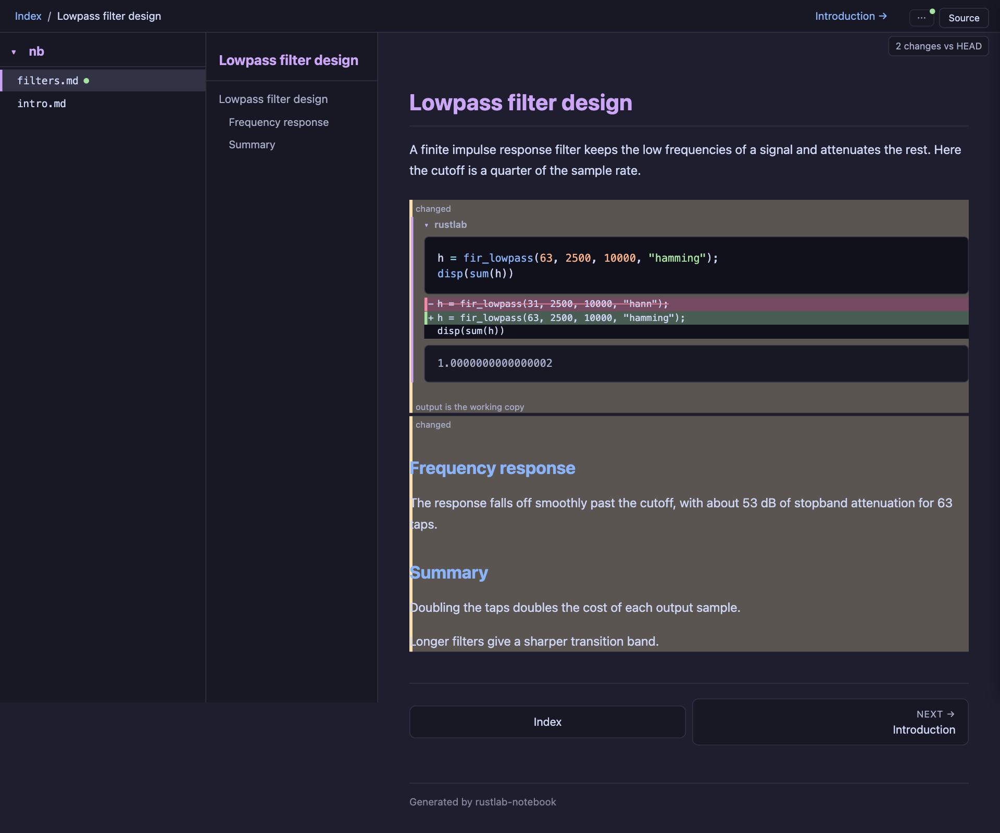
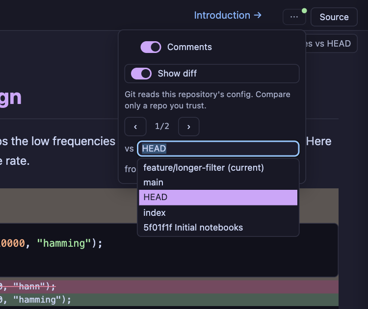
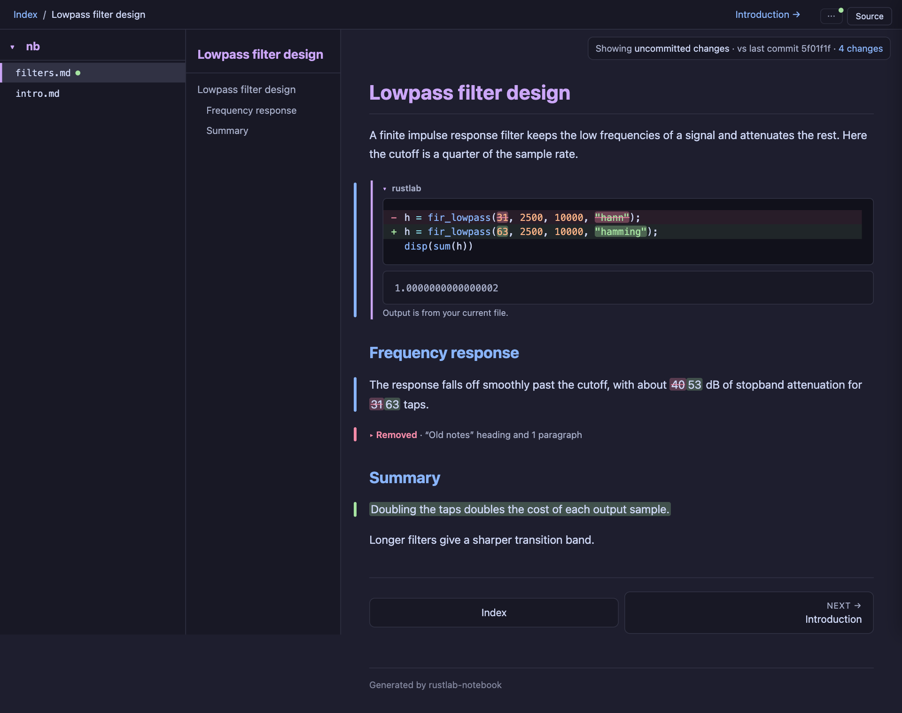
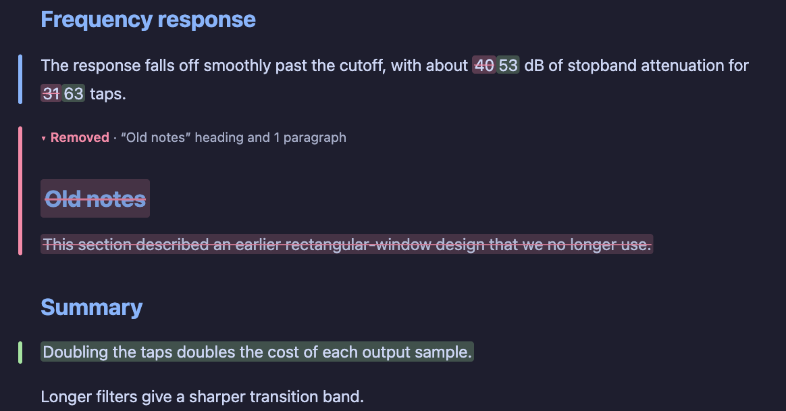
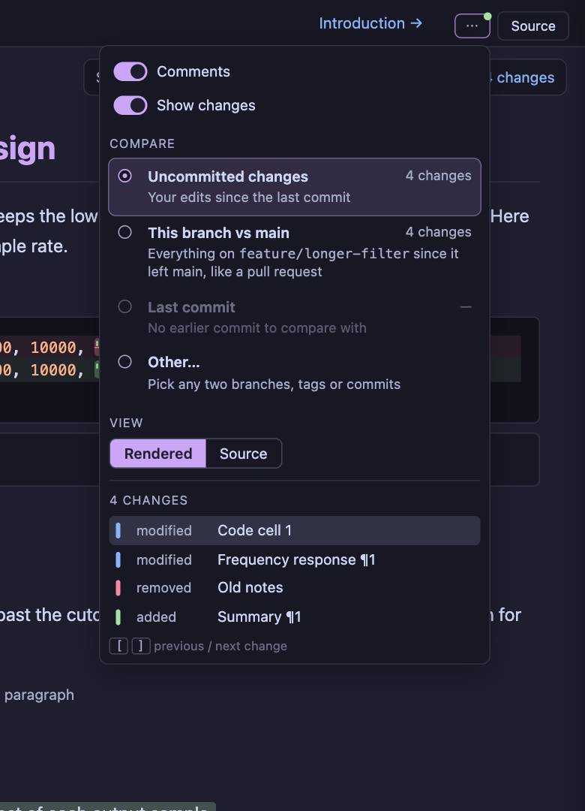
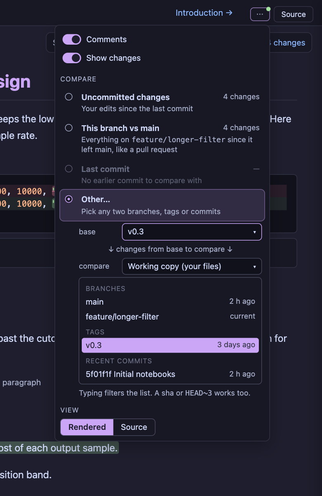
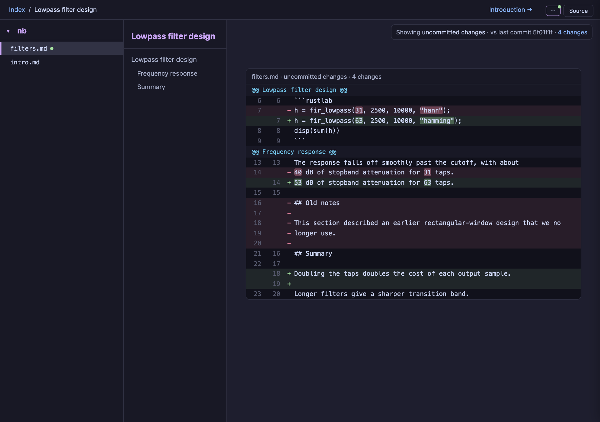

# Plan: familiar git diff view in `notebook watch`

**Status:** complete
**Current phase:** complete (A, B and C shipped); static `render --diff` is the remaining follow-up in `notebook_git_diff.md`
**Created:** 2026-10-22
**Replaces:** phase 2 of [`notebook_git_diff.md`](notebook_git_diff.md) (word-level prose and the source diff move here). Phase 1 there shipped in 0.3.12–0.3.13; its git plumbing, security model, ref checker and per-page refs stay as they are.
**Mockups:** `assets/notebook_git_diff_ux/`. Built from a real `watch --git-diff` page on a demo repo; `mockup.mjs` repaints that page (puppeteer-core with the local Chrome) and is not product code.

## Why

Two complaints after using phase 1: the highlighting is not intuitive, and it is not clear how to pick "my local changes" in the picker.

What the current page does (`before-page.png`, `before-picker.png`):

- **Picker.** Two free-text fields, `vs [HEAD]` and `from [ ]`, where an empty `from` means the working copy. Nothing says "uncommitted changes". The list mixes `HEAD`, `index` and shas. A branch is compared at its tip, so newer commits on `main` show up as reversed edits.
- **Whole-block marks.** All the prose between two code cells is one block. In the demo, a two-number edit, a removed section and an added paragraph merge into one amber "changed" block that runs from *Frequency response* to the end. **The removed "Old notes" section is not shown at all.**
- **Amber "changed"** says something changed but not what. No common tool uses amber for this.
- **Code cells show the source twice:** the normal listing, then the line diff under it.
- Text inside a marked block sits flush against the bar.

## What popular tools do

| Tool | Use | Choosing what to compare | Showing changes |
|---|---|---|---|
| GitHub pull requests and rendered prose diff | Where most review happens | `base: main ← compare: feature`, from the merge base | Words: green background added, red background and struck out removed, in the rendered text |
| VS Code Source Control | 75.9 % of developers (Stack Overflow 2025) | Named groups: *Changes*, *Staged Changes*. Compare with a branch or tag is a separate action | 3 px gutter bar (green added, blue modified, red marker deleted) plus word emphasis inside lines |
| delta (32.6k ★), difftastic (26.0k ★), diff-so-fancy (18.1k ★) | Most-starred terminal diff tools | — | All emphasize the changed words inside a changed line |
| nbdime (GitHub's notebook diff), ReviewNB | Jupyter | Inherited from GitHub | Per cell: source diff, outputs below |

Common ground: start from named presets, show the exact changed words, keep block color to a thin bar. Side-by-side is not part of this plan (decided 2026-10-22).

## Proposed view

### Page

- **Gutter bars, no washes.** A 4 px bar left of the text: green added, blue modified, red removed. Body text keeps `--rl-text`. No amber.
- **Word-level marks.** Inside a modified paragraph, removed words have a red background and are struck through; added words have a green background (GitHub's rendered prose diff). An added paragraph is all green background.
- **Paragraph-level alignment.** Units are top-level markdown nodes (heading, paragraph, list, table, quote, fence), not the whole prose run between code cells. In the demo only the edited paragraph is marked, and *Summary* stays unmarked.
- **Removed text collapses** to one line, `▸ Removed · "Old notes" heading and 1 paragraph`, at its old position. Clicking expands it:

  

- **Code cells show one listing:** the diff itself. Context lines keep syntax colors, changed lines get a faint line tint, and the changed tokens (`31` → `63`, `"hann"` → `"hamming"`) get the strong color. The output stays the working copy, labelled "Output is from your current file."
- **Status chip** at the top right says, in words, what is being compared: *Showing uncommitted changes · vs last commit 5f01f1f · 4 changes*. Clicking it opens the menu.

### Menu: presets first

- **Show changes** (renamed from Show diff) stays the on/off switch.
- **Compare** is a radio list with a change count for each:
  - **Uncommitted changes**: working copy vs `HEAD`. The default.
  - **This branch vs main**: working copy vs the merge base with the default branch, like a pull request. Hidden on the default branch itself.
  - **Last commit**: `HEAD~1` → `HEAD`. Disabled with a reason when `HEAD` has no parent.
  - **Other…**: any two refs (below).
- **View: Rendered | Source** (GitHub's toggle above a prose diff).
- **Change list** replaces `‹ 1/2 ›`. Each row is a kind and a place: the nearest heading plus `¶n`, or `Code cell n`. Clicking a row scrolls to it. `[` and `]` still step.

### Other…

- Two fields with GitHub's words: **base** (before) and **compare** (after), and an arrow *changes from base to compare*. compare defaults to **Working copy (your files)**.
- The list is grouped (*Branches*, *Tags*, *Recent commits*) with relative times. Typing filters. A sha or `HEAD~3` still works.
- `index` stops being a list entry. It is dropped, not made a preset (decision 2).

### Source view

A unified diff of the `.md`, with old and new line numbers, word emphasis inside changed lines, and hunk headers named after the nearest heading. Read-only. It replaces the rendered page in `<main>` while selected; the existing Source pane (`/raw/`) is unchanged.

## Design details

### Presets and the URL

The page stays the only owner of the comparison (per-page, not per-server, as decided in phase 1).

| Preset | Query | before | after |
|---|---|---|---|
| Uncommitted changes | `?changes=uncommitted` | `HEAD` | working copy |
| This branch vs main | `?changes=branch` | `merge-base(<default>, HEAD)` | working copy |
| Last commit | `?changes=last` | `HEAD~1` | `HEAD` |
| Other… | `?changes=custom&base=<ref>&compare=<ref>` | `base` | `compare` (absent = working copy) |
| Off | `?changes=off` | | |

- `<default>` is `main`, else `master`, else the branch `refs/remotes/origin/HEAD` points at, from the existing `for-each-ref` listing.
- The merge base needs `git-merge-base`, a plumbing binary. It joins the allowed list in `gitdiff.rs`, with the same environment and config overrides.
- **Compatibility.** Phase 1 shipped `?diff=<ref>` (the before side) and `?base=<ref>` (the after side). That `base` is the opposite of GitHub's word. Old links keep working: `?diff=X` maps to `custom` with base X, and the old `?base=Y` maps to `compare=Y` *only when `?changes` is absent*. `--diff <ref>` keeps its meaning (the default before side). This is a visible change, so it goes in the CHANGELOG with migration notes.
- Counts come from the same align step per preset (one file, three alignments). They are computed when the menu opens (`GET /git/changes?slug=`, read-only, like `/git/refs`), not on every render.

### Alignment units

Phase 1 aligns `parse_notebook` blocks. A markdown block is everything between two fences, which is why one edit marks a whole run and why a removed section vanished.

- Split each markdown block into top-level units using pulldown-cmark's offset iterator, the parser the renderer already uses. Fingerprint each unit (kind plus normalized source) and run the existing LCS on units.
- Code, mermaid and widget blocks stay one unit each.
- Rendering: the prose HTML for a block is still produced once by the normal path. Each top-level element is then matched to its unit by order. A block whose element count differs from its unit count (raw HTML, footnote definitions, link reference definitions) falls back to whole-block marking for that block.
- Removed units are rendered from the old source by the normal markdown path, inside a collapsed `
`.

### Word level

- Only for a matched pair of units of the same kind (two paragraphs, two headings, two list items at the same depth). A list or table pair whose structure changed is a whole-unit change.
- Tokens: words, whitespace and punctuation, with `$…$` / `$$…$$`, inline code, links and `==…==` / `%%…%%` as single tokens. LCS on tokens.
- If fewer than half the tokens survive, show the pair as removed plus added, not as confetti.
- Marks go in on the **source**, as private-use placeholder pairs (the `protect_math` technique), before markdown rendering, and become `<ins class="rl-w">` / `<del class="rl-w">` after it. A math token is replaced whole, so KaTeX still sees a complete span.
- Code lines: the same token LCS on each changed line pair inside a cell. The syntax highlighter's spans are merged with the change ranges, so tokens keep their colors.

### Colors

New `ThemeColors` tokens for all four themes; the phase 1 wash tokens are removed.

| Token | Use | Rule |
|---|---|---|
| `--rl-dx-add-bar`, `--rl-dx-mod-bar`, `--rl-dx-del-bar` | 4 px gutter bar | ≥ 3:1 against `--rl-bg` (non-text) |
| `--rl-dx-add-word`, `--rl-dx-del-word` | word background | `--rl-text` on it ≥ 4.5:1; on code, each syntax color on it ≥ 4.5:1 |
| `--rl-dx-add-line`, `--rl-dx-del-line` | faint line tint in code | same 4.5:1 rule |

Blue for modified is `accent_secondary`, which mocha also uses for headings. The bar is in the gutter, not under text, so they don't compete; check this on Latte. A code cell already has an accent rule on its left edge, so its bar sits one gutter further out.

### Live updates

Unchanged from phase 1: a diff query reloads on `full` / `partial` / `reconcile`. The collapsed or expanded state of removed blocks is kept across that reload in `sessionStorage`, keyed by unit fingerprint.

## Phases

Each phase ships alone and bumps the version (rule 12).

### Phase A: presets, status, list, styling

**Status:** complete (0.3.15, PR #88). Screenshots of the shipped view: `assets/notebook_git_diff_ux/phase-a-*.png`.

- Presets, the `?changes=` scheme with the compatibility mapping, and `git-merge-base`. **done**
- Status chip, change list, *Show changes* rename, *Other…* with base/compare and the grouped list. **done**
- Gutter bars instead of washes, collapsed removed blocks, a single listing in code cells (the line diff becomes the listing). **done**
- Paragraph-level alignment units, which fixes the invisible removal and the whole-run marks. **done**

Notes from the build:
- Two refs no longer swap by commit date; `base` is always the before side (CHANGELOG 0.3.15).
- The code-line tints keep the code panel's luminance, because the comment color sits at 4.5:1 on that panel and any lighter wash fails. On dark themes the tint is faint; the `−` / `+` gutter and a 2 px line bar carry the change. Phase B's word backgrounds face the same limit.
- The unit cap is 1500 (was 400 blocks), since prose now splits per paragraph.

### Phase B: word level

**Status:** complete (0.3.16).

- Word marks in prose and in code lines, as above, with the survival threshold. **done**

Notes from the build:
- `worddiff.rs` tokenizes and compares; prose marks are private-use markers in the merged source, rendered with the notebook's own link mode and then turned into `<del class="rl-w">` / `<ins class="rl-w">`. The re-render must come back as one element of the same tag with balanced markers, or the unit keeps its bar only.
- Word marks apply to paragraphs, headings, lists and quotes. A changed `*`, `_`, `~`, `` ` ``, `#` or `|` (and, outside paragraphs, a list or quote marker or a line break) keeps the bar only, as does a unit with an image, footnote, `%%` comment or `==` highlight (the full render rewrites those).
- Prose word tints keep body text at 4.5:1, but accent colors miss it on some themes, so a link inside a mark takes the body text color. Headings and code use a 2 px underline (added) or strike (removed) in the bar color instead of a tint.

### Phase C: source view

**Status:** complete (0.3.16).

- Rendered / Source toggle and the unified `.md` diff with word emphasis and named hunks. **done**
- The size cap (512 KiB, 1500 units) falls back to this view instead of no marks. **done**

Notes from the build:
- `srcdiff.rs`: lines unique to both sides anchor first (patience), then Myers fills the gaps. Plain minimal Myers matched blank lines and paired `## Old notes` with `## Summary` in the demo; the anchors make the removed section one block, like `git diff --patience`. Myers keeps only the reachable frontier per step (O(D²) memory) and gives up past D = 2000, treating the rest as a block replace.
- Hunks carry `data-rl-dx`, so the change list and `[` / `]` work in the Source view too.

Static `render --diff` (phase 3 of the first plan) is unchanged and comes after these.

## Tests

Same rule as phase 1: headless, no browser, real `git` only in the fixture tests.

| Test | What it pins |
|---|---|
| Preset mapping | Each `?changes=` value gives the right before/after; old `?diff=` / `?base=` links resolve as today; `?changes=off` wins. |
| Merge base | Fixture repo with `main` moved ahead: *This branch vs main* does not show `main`'s newer commits as removals. |
| Default branch | `main`, `master`, and `origin/HEAD` fallbacks; the preset is hidden on the default branch. |
| Last commit | Disabled with a reason on a root commit. |
| Units | The demo notebook (`assets/…/mockup.mjs` documents it): one modified paragraph, one removed heading-plus-paragraph, one added paragraph, *Summary* unmarked. |
| Fallback | Raw HTML or a footnote in a block yields whole-block marks for that block only. |
| Removed | A removed unit renders inside `details.rl-dx-removed`, collapsed, at its old position. |
| Code listing | A changed cell contains the source once. |
| Words | `40` → `53` marks two tokens; a `$x$` → `$y$` change replaces the whole span and the HTML still has one `\(…\)` span; under 50 % survival gives removed plus added. |
| Code words | Changed tokens keep their `syn-*` class. |
| Contrast | The new tokens meet the table above on all four palettes. |
| No new POST | Router test, as in phase 1. `/git/changes` is GET only and returns "git diff is off" without spawning git when git is off. |

## Decisions (2026-10-22)

1. **This branch vs main** includes uncommitted edits: working copy vs merge base.
2. **Staged changes**: `index` is dropped from the list. No *Staged changes* preset.
3. **URL**: `?changes=` / `base` / `compare`, with the compatibility mapping above and a CHANGELOG entry.
4. **Order**: A, then B, then C, each in its own PR with its own version bump.

## Implementation notes

- Files: `gitdiff.rs` (units, tokens, presets, merge base), `server/page.rs` (menu, chip, CSS), `server/http.rs` (`/git/changes`, query parsing), `rustlab-plot` `theme.rs` (tokens), `render.rs` only for the placeholder-to-`<ins>`/`<del>` pass.
- Docs: `docs/notebooks.md` (diff section rewritten around presets), `docs/security.md` (`git-merge-base` on the allowed list), `examples/notebooks/git_diff.md`, `CHANGELOG.md` (behavior change: URL, labels, styling), `AGENTS.md` row.
- Verify on all four themes with real screenshots before merging. `mockup.mjs` is the harness to reuse.
