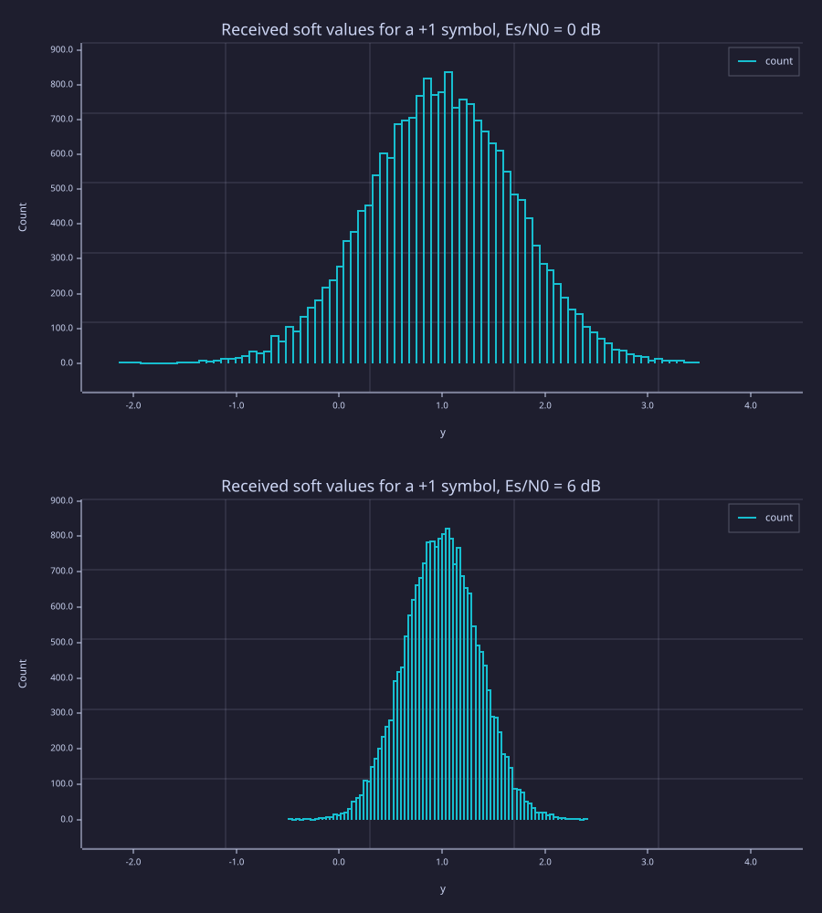
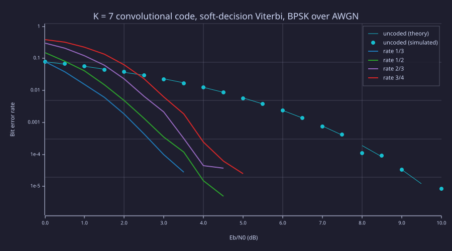
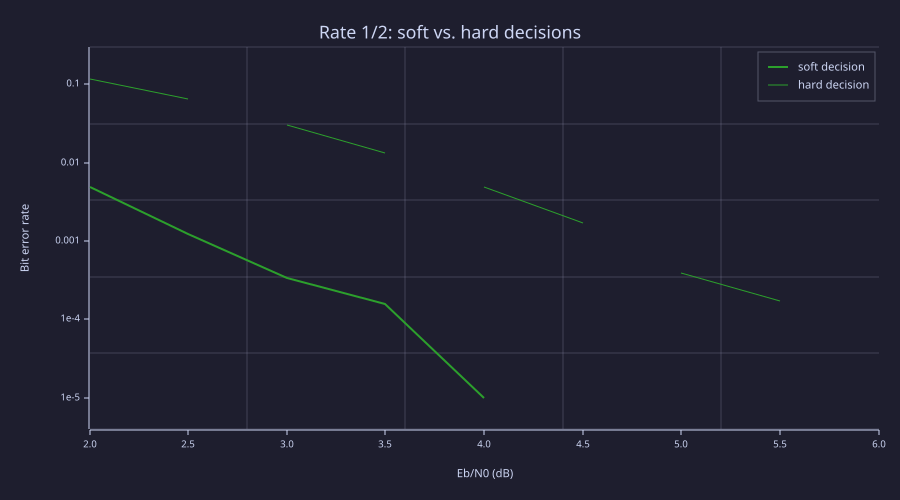
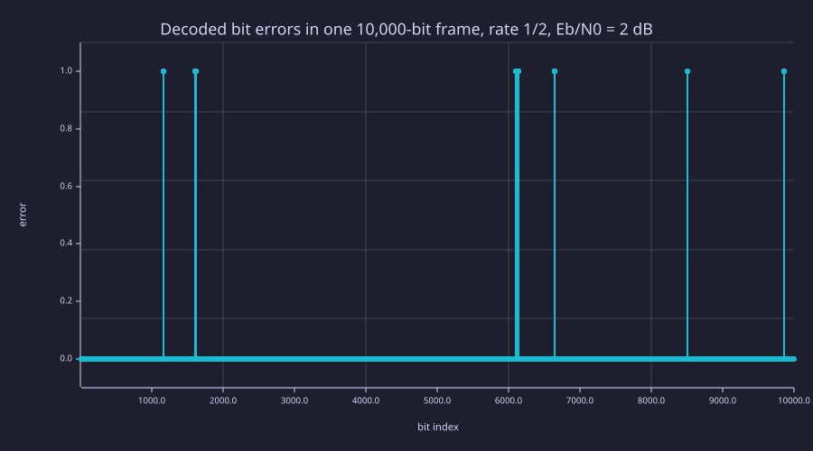

<!-- Generated by rustlab-notebook — do not edit directly. -->

# Viterbi Decoding of Convolutional Codes

Forward error correction (FEC) adds structured redundancy to a bit stream
so the receiver can correct errors the channel introduces. This notebook
builds a complete convolutional-code link in rustlab:

1. an encoder for the constraint-length-7 code with generators 133 and 171
   (octal), the code used by deep-space links, 802.11a/g and DVB;
2. a soft-decision Viterbi decoder over its 64-state trellis;
3. a BPSK link over additive white Gaussian noise (AWGN);
4. four coding rates (1/3, 1/2, and punctured 2/3 and 3/4), compared by bit
   error rate (BER) against uncoded BPSK.

Every random draw goes through `seed`, so the figures are the same on each
render.

## The encoder

A rate-$1/n$ convolutional encoder shifts each input bit $u_t$ into a
register that holds the last $K = 7$ inputs. Each of the $n$ outputs is the
modulo-2 sum of the register taps selected by one generator polynomial:

$$c^{(j)}_t = \sum_{k=0}^{K-1} g^{(j)}_k \, u_{t-k} \pmod 2$$

That sum is a convolution, so `convolve` followed by `mod(·, 2)` is the
whole encoder. Six zero tail bits return the register to the all-zero state,
which tells the decoder where the trellis ends.

```rustlab
# Generator taps, current input first.  Octal 133 = 1 011 011, 171 = 1 111 001,
# 165 = 1 110 101.
G2 = [1 0 1 1 0 1 1; 1 1 1 1 0 0 1];                  # rate 1/2
G3 = [1 0 1 1 0 1 1; 1 1 1 1 0 0 1; 1 1 1 0 1 0 1];   # rate 1/3

function c = conv_encode(u, G)
  # u: row of info bits.  c: n x (length(u) + 6) code bits, one column per step.
  x = [u, zeros(1, 6)];
  L = length(x);
  n = size(G, 1);
  c = zeros(n, L);
  for j = 1:n
    v = convolve(x, G(j, :));
    c(j, :) = mod(v(1:L), 2);
  end
end

c = conv_encode([1 0 1 1 0 0 1 0], G2)
```

Each column is one trellis step: the two code bits sent for one input bit.

## The trellis

The decoder's state is the previous six inputs, so there are $2^6 = 64$
states. With the newest bit stored in the most significant position, input
$u$ moves state $s$ to

$$s' = \lfloor s/2 \rfloor + 32\,u .$$

Every state $s'$ therefore has exactly two predecessors,
$s = 2\,(s' \bmod 32) + b$ for $b \in \{0, 1\}$, and both transitions carry
the same input bit $u = \lfloor s'/32 \rfloor$. For each of the 128
transitions the table below stores the predecessor and the expected
transmitted symbols, already mapped to BPSK ($0 \to +1$, $1 \to -1$).

```rustlab
function [P0, P1, C0, C1] = trellis(G)
  n = size(G, 1);
  P0 = zeros(1, 64); P1 = zeros(1, 64);
  C0 = zeros(64, n); C1 = zeros(64, n);
  for ns = 0:63
    u = floor(ns / 32);
    for b = 0:1
      s = mod(ns, 32) * 2 + b;
      reg = [u, mod(floor(s ./ [32, 16, 8, 4, 2, 1]), 2)];
      sym = 1 - 2 * mod(G * reg', 2);
      if b == 0
        P0(ns + 1) = s + 1;
        C0(ns + 1, :) = sym';
      else
        P1(ns + 1) = s + 1;
        C1(ns + 1, :) = sym';
      end
    end
  end
end

[P0, P1, C0, C1] = trellis(G2);
```

## The Viterbi decoder

Given received soft values $y_t$ (one per transmitted symbol), the
maximum-likelihood path through the trellis maximizes the correlation
$\sum_t \mathbf{c}_t \cdot \mathbf{y}_t$ between expected and received
symbols. The Viterbi algorithm finds it by keeping, for every state, only
the best path that reaches it:

- **Branch metrics.** $\mathbf{c} \cdot \mathbf{y}_t$ for all 128 transitions
  and all steps at once is two matrix products, `C0 * Y` and `C1 * Y`.
- **Add-compare-select.** At each step, each state adds the branch metric
  to its two predecessors' path metrics, keeps the larger, and records which
  predecessor won. The 64 states update together as vectors.
- **Traceback.** The tail bits force the final state to 0. Following the
  recorded decisions backwards from there reads the input bits out in
  reverse.

A punctured or erased symbol is a $0$ in $Y$: it adds nothing to any branch
metric, so the decoder simply relies on the symbols around it.

```rustlab
function u = viterbi(Y, P0, P1, C0, C1)
  # Y: n x L soft values (+1 means code bit 0), 0 where nothing was received.
  L = size(Y, 2);
  pm = -1e9 * ones(1, 64);
  pm(1) = 0;                       # the encoder starts in state 0
  B0 = C0 * Y;
  B1 = C1 * Y;
  D = zeros(64, L);
  for t = 1:L
    a = pm(P0) + B0(:, t);
    b = pm(P1) + B1(:, t);
    D(:, t) = b > a;
    pm = max(a, b);
  end
  s = 0;                           # the tail bits end it in state 0
  u = zeros(1, L);
  for t = L:-1:1
    u(t) = floor(s / 32);
    s = mod(s, 32) * 2 + D(s + 1, t);
  end
  u = u(1:L-6);
end

seed(7);
u = randi([0, 1], 1, 1000);
x = 1 - 2 * conv_encode(u, G2);
noiseless_errors = sum(viterbi(x, P0, P1, C0, C1) != u)
```

With no noise the decoder returns the input exactly.

## The channel

BPSK sends each code bit as $\pm 1$, so every transmitted symbol has
energy $E_s = 1$. With $R$ information bits per transmitted symbol, each
information bit costs $E_b = E_s / R$, and AWGN of one-sided density $N_0$
has per-sample standard deviation

$$\sigma = \sqrt{\frac{N_0}{2}} = \sqrt{\frac{1}{2\,R\,E_b/N_0}} .$$

Comparing codes at equal $E_b/N_0$ is the fair test: a lower-rate code
sends more symbols per bit, so each symbol is noisier, and the code has to
earn that back.

```rustlab
clf
seed(3);
subplot(2, 1, 1)
histogram(1 + sqrt(1 / (2 * 10^(0 / 10))) * randn(1, 20000), 80)
title("Received soft values for a +1 symbol, Es/N0 = 0 dB")
xlim([-2.5, 4.5])
xlabel("y")
subplot(2, 1, 2)
histogram(1 + sqrt(1 / (2 * 10^(6 / 10))) * randn(1, 20000), 80)
title("Received soft values for a +1 symbol, Es/N0 = 6 dB")
xlim([-2.5, 4.5])
xlabel("y")
```

<!-- rustlab:output-start -->


<!-- rustlab:output-end -->

At 0 dB about 8 % of the samples land on the wrong side of zero. A
hard decision throws away how far they landed; a soft-decision decoder
keeps it.

## Coding rates and puncturing

Lower rates add more redundancy. Rate 1/3 sends three symbols per bit,
rate 1/2 two. Higher rates come from **puncturing** the rate-1/2 output:
a fixed pattern deletes some symbols before transmission, and the receiver
puts zeros (erasures) back in their places. The 802.11a patterns, with
rows for the two generator outputs and columns for consecutive steps, are

$$P_{2/3} = \begin{pmatrix} 1 & 1 \\ 1 & 0 \end{pmatrix}, \qquad
  P_{3/4} = \begin{pmatrix} 1 & 1 & 0 \\ 1 & 0 & 1 \end{pmatrix}.$$

The same decoder and trellis serve all three rates built from the
rate-1/2 code.

```rustlab
function M = puncture_mask(P, L)
  p = size(P, 2);
  M = repmat(P, 1, ceil(L / p));
  M = M(:, 1:L);
end

# Everything a link needs: generators, puncturing pattern, trellis tables.
function T = make_code(G, P)
  [P0, P1, C0, C1] = trellis(G);
  T.G = G; T.P = P;
  T.P0 = P0; T.P1 = P1; T.C0 = C0; T.C1 = C1;
  T.rate = size(P, 2) / sum(sum(P));
end

# One frame through the channel: returns the number of bit errors.
function e = frame_errors(N, ebn0_db, T, hard)
  u = randi([0, 1], 1, N);
  x = 1 - 2 * conv_encode(u, T.G);
  M = puncture_mask(T.P, size(x, 2));
  sigma = sqrt(1 / (2 * T.rate * 10^(ebn0_db / 10)));
  Y = (x + sigma * randn(size(x, 1), size(x, 2))) .* M;
  if hard
    Y = sign(Y);
  end
  e = sum(viterbi(Y, T.P0, T.P1, T.C0, T.C1) != u);
end

# Uncoded BPSK: one symbol per bit, decided by sign.
function e = uncoded_errors(N, ebn0_db)
  u = randi([0, 1], 1, N);
  y = 1 - 2 * u + sqrt(1 / (2 * 10^(ebn0_db / 10))) * randn(1, N);
  e = sum((y < 0) != u);
end

codes.r13 = make_code(G3, [1; 1; 1]);
codes.r12 = make_code(G2, [1; 1]);
codes.r23 = make_code(G2, [1 1; 1 0]);
codes.r34 = make_code(G2, [1 1 0; 1 0 1]);
rate_34 = codes.r34.rate
```

The 3/4 pattern covers three steps (three information bits) and keeps
four of their six symbols. The tail bits are ignored in the rate; they add
six steps to a 10,000-bit frame.

## Bit error rate vs. $E_b/N_0$

Each point decodes `n_frames` frames of 10,000 bits. The frames are
independent, so `parmap` spreads them over all cores; its per-task random
streams are derived from the master `seed`, so the result does not depend
on the thread count.

The theory curve for uncoded BPSK is $P_b = Q\!\left(\sqrt{2 E_b/N_0}\right)$.
rustlab has no `erfc`, so $Q$ comes from Craig's exact integral

$$Q(x) = \frac{1}{\pi} \int_0^{\pi/2}
  \exp\!\left(-\frac{x^2}{2 \sin^2 \theta}\right) d\theta ,
  \qquad x \ge 0,$$

whose integrand is smooth and bounded, so `trapz` on a fine grid gets it to
many digits.

```rustlab
function q = qfunc(x)
  theta = linspace(1e-6, pi / 2, 2000);
  q = zeros(1, length(x));
  for k = 1:length(x)
    q(k) = trapz(theta, exp(-x(k)^2 ./ (2 * sin(theta).^2))) / pi;
  end
end

N = 10000;

# Uncoded BPSK is cheap: simulate it out to 10 dB.
ebn0_u = 0:0.5:10;
n_frames_u = 12;
seed(2026);
e_u = parmap(@(k) uncoded_errors(N, ebn0_u(floor((k - 1) / n_frames_u) + 1)), 1:(length(ebn0_u) * n_frames_u));
ber_u = sum(reshape(e_u, n_frames_u, length(ebn0_u)), 1) / (N * n_frames_u);
theory = qfunc(sqrt(2 * 10.^(ebn0_u / 10)));

# The coded links, 40 frames (400,000 bits) per point up to 6 dB.
names = {"rate 1/3", "rate 1/2", "rate 2/3", "rate 3/4"};
ebn0 = 0:0.5:6;
nE = length(ebn0);
n_frames = 40;
n_codes = 4;

# Task k is one frame of one code at one Eb/N0.
function e = ber_task(k, codes, N, n_frames, ebn0)
  nE = length(ebn0);
  code = floor((k - 1) / (nE * n_frames)) + 1;
  db = ebn0(mod(floor((k - 1) / n_frames), nE) + 1);
  if code == 1
    e = frame_errors(N, db, codes.r13, false);
  elseif code == 2
    e = frame_errors(N, db, codes.r12, false);
  elseif code == 3
    e = frame_errors(N, db, codes.r23, false);
  else
    e = frame_errors(N, db, codes.r34, false);
  end
end

errs = parmap(@(k) ber_task(k, codes, N, n_frames, ebn0), 1:(n_codes * nE * n_frames));
ber = reshape(sum(reshape(errs, n_frames, n_codes * nE), 1), nE, n_codes)' / (N * n_frames);
```

`ber` has one row per code. At every whole dB, next to uncoded BPSK in
theory (a dash means no errors in the 400,000 bits sent):

```rustlab
function row(label, v)
  fprintf("%-18s", label);
  for k = 1:length(v)
    if v(k) > 0
      fprintf("%9.1e", v(k));
    else
      fprintf("%9s", "-");
    end
  end
  fprintf("\n");
end

fprintf("%-18s", "Eb/N0 (dB)");
for db = 0:6
  fprintf("%9d", db);
end
fprintf("\n");
row("uncoded (theory)", theory(1:2:13));
for c = 1:n_codes
  row(names(c), ber(c, 1:2:nE));
end
```

<!-- rustlab:output-start -->
```text
Eb/N0 (dB)                0        1        2        3        4        5        6
uncoded (theory)    7.9e-02  5.6e-02  3.8e-02  2.3e-02  1.3e-02  6.0e-03  2.4e-03
rate 1/3            7.8e-02  1.6e-02  1.9e-03  1.0e-04        -        -        -
rate 1/2            1.5e-01  4.1e-02  4.9e-03  3.4e-04  1.5e-05        -        -
rate 2/3            3.0e-01  1.2e-01  2.3e-02  2.1e-03  4.5e-05        -        -
rate 3/4            3.8e-01  2.3e-01  6.4e-02  6.3e-03  2.5e-04  2.5e-05        -
```

<!-- rustlab:output-end -->

A point with no errors has no meaningful BER on a log axis, so each curve
in the plot stops at its last nonzero point.

```rustlab
clf
specs = {"b-", "g-", "m-", "r-"};
semilogy(ebn0_u, theory, "c--")
hold on
semilogy(ebn0_u(find(ber_u > 0)), ber_u(find(ber_u > 0)), "co")
for c = 1:n_codes
  keep = find(ber(c, :) > 0);
  semilogy(ebn0(keep), ber(c, keep), specs(c))
end
hold off
legend("uncoded (theory)", "uncoded (simulated)", names(1), names(2), names(3), names(4))
title("K = 7 convolutional code, soft-decision Viterbi, BPSK over AWGN")
xlabel("Eb/N0 (dB)")
ylabel("Bit error rate")
grid on
```

<!-- rustlab:output-start -->


<!-- rustlab:output-end -->

At low $E_b/N_0$ a coded link is worse than sending no code at all. The
decoder needs enough reliable symbols around each error to find the right
path, and every wrong path it follows costs a burst of errors. The higher
the rate, the later a code breaks even: rate 1/3 matches uncoded BPSK at
0 dB, rate 3/4 only near 2 dB. Past that point the coded curves fall far
faster. At 6 dB uncoded BPSK still gets one bit in 419
wrong, while no coded link made a single error in its 400,000 bits.

## Coding gain

The coding gain is how much less $E_b/N_0$ a code needs than uncoded BPSK
for the same BER. The crossing of $10^{-4}$ comes from interpolating
$\log_{10}$ BER linearly between grid points. The last column is the
Shannon limit for each rate on a real-valued Gaussian channel,
$E_b/N_0 \ge (2^{2R} - 1)/(2R)$: no code of that rate can do better.

```rustlab
function x0 = crossing(x, y, target)
  # First x where y falls through target, interpolating log10(y).
  # NaN when the curve never crosses within the measured points.
  x0 = NaN;
  found = false;
  k = 1;
  while k < length(y) && !found
    if y(k) >= target && y(k + 1) < target && y(k + 1) > 0
      a = log10(y(k)); b = log10(y(k + 1));
      x0 = x(k) + (log10(target) - a) / (b - a) * (x(k + 1) - x(k));
      found = true;
    end
    k = k + 1;
  end
end

rates = [codes.r13.rate, codes.r12.rate, codes.r23.rate, codes.r34.rate];
shannon_db = @(r) 10 * log10((2^(2 * r) - 1) / (2 * r));
ref = crossing(ebn0_u, theory, 1e-4);
fprintf("%-18s %8s %16s %13s %15s\n", "code", "bits/sym", "Eb/N0 @ 1e-4", "coding gain", "Shannon limit");
fprintf("%-18s %8.3f %13.2f dB %13s %12.2f dB\n", "uncoded (theory)", 1, ref, "-", shannon_db(1));
need = zeros(1, n_codes);
for c = 1:n_codes
  need(c) = crossing(ebn0, ber(c, :), 1e-4);
  fprintf("%-18s %8.3f %13.2f dB %10.2f dB %12.2f dB\n", names(c), rates(c), need(c), ref - need(c), shannon_db(rates(c)));
end
```

<!-- rustlab:output-start -->
```text
code               bits/sym     Eb/N0 @ 1e-4   coding gain   Shannon limit
uncoded (theory)      1.000          8.39 dB             -         1.76 dB
rate 1/3              0.333          3.00 dB       5.39 dB        -0.55 dB
rate 1/2              0.500          3.54 dB       4.85 dB         0.00 dB
rate 2/3              0.667          3.79 dB       4.60 dB         0.57 dB
rate 3/4              0.750          4.33 dB       4.06 dB         0.86 dB
```

<!-- rustlab:output-end -->

At $10^{-4}$ the rate-1/2 code needs 3.5 dB where uncoded BPSK
needs 8.4 dB. That 4.8 dB is about
3× less transmit power per bit, paid for
with half the throughput. Rate 1/3 buys another
0.5 dB for half as many symbols again. Puncturing to
3/4 gives back 0.8 dB and sends a third fewer
symbols than rate 1/2. Every rate stays about
3.5 dB from its Shannon limit, the gap that
turbo and LDPC codes closed in the 1990s.

## Hard vs. soft decisions

A hard-decision receiver turns each sample into a bit before decoding,
here by replacing $Y$ with `sign(Y)`. The decoder is unchanged; it now
counts agreements instead of weighing confidence.

```rustlab
seed(11);
ebn0_h = 2:0.5:6;
nH = length(ebn0_h);
function e = hs_task(k, T, N, n_frames, ebn0_h)
  nH = length(ebn0_h);
  hard = k > nH * n_frames;
  db = ebn0_h(mod(floor((k - 1) / n_frames), nH) + 1);
  e = frame_errors(N, db, T, hard);
end
e_hs = parmap(@(k) hs_task(k, codes.r12, N, n_frames, ebn0_h), 1:(2 * nH * n_frames));
ber_hs = reshape(sum(reshape(e_hs, n_frames, 2 * nH), 1), nH, 2)' / (N * n_frames);

clf
keep_s = find(ber_hs(1, :) > 0);
keep_h = find(ber_hs(2, :) > 0);
semilogy(ebn0_h(keep_s), ber_hs(1, keep_s), "g-")
hold on
semilogy(ebn0_h(keep_h), ber_hs(2, keep_h), "g--")
hold off
legend("soft decision", "hard decision")
title("Rate 1/2: soft vs. hard decisions")
xlabel("Eb/N0 (dB)")
ylabel("Bit error rate")
grid on

soft_db = crossing(ebn0_h, ber_hs(1, :), 1e-4);
hard_db = crossing(ebn0_h, ber_hs(2, :), 1e-4);
fprintf("Eb/N0 at BER 1e-4: soft %.2f dB, hard %.2f dB, soft-decision gain %.2f dB\n", soft_db, hard_db, hard_db - soft_db);
```

<!-- rustlab:output-start -->
```text
Eb/N0 at BER 1e-4: soft 3.58 dB, hard 5.75 dB, soft-decision gain 2.17 dB
```



<!-- rustlab:output-end -->

The textbook figure for unquantized soft decisions on AWGN is about 2 dB,
and the simulation gives 2.2 dB: knowing which
symbols are unreliable is worth
45 % of everything the
code gains at this BER.

## Error bursts

A Viterbi decoder does not make isolated mistakes. When it leaves the
correct path, it follows a wrong one for a few constraint lengths before
the paths merge again, so its errors arrive in clusters. Here is one
frame at 2 dB on the rate-1/2 code:

```rustlab
seed(5);
Nb = 10000;
u = randi([0, 1], 1, Nb);
x = 1 - 2 * conv_encode(u, G2);
sigma = sqrt(1 / (2 * 0.5 * 10^(2 / 10)));
Y = x + sigma * randn(size(x, 1), size(x, 2));
err = viterbi(Y, P0, P1, C0, C1) != u;
pos = find(err);

clf
stem(1:Nb, err)
title("Decoded bit errors in one 10,000-bit frame, rate 1/2, Eb/N0 = 2 dB")
xlabel("bit index")
ylabel("error")

# Group errors that are closer than one constraint length into bursts.
n_bursts = 0;
if length(pos) > 0
  n_bursts = 1 + sum(diff(pos) > 7);
end
fprintf("%d bit errors in %d bursts, %.1f errors per burst\n", length(pos), n_bursts, length(pos) / max(n_bursts, 1));
```

<!-- rustlab:output-start -->
```text
57 bit errors in 6 bursts, 9.5 errors per burst
```



<!-- rustlab:output-end -->

This clustering is why systems that need very low error rates follow a
convolutional code with an interleaver and a Reed-Solomon outer code:
the interleaver spreads each burst across many Reed-Solomon codewords,
each of which can repair a few byte errors.
