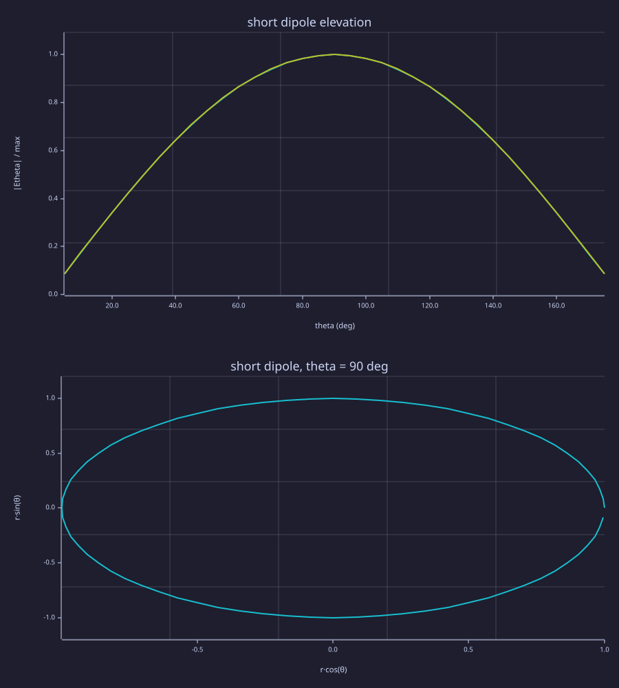
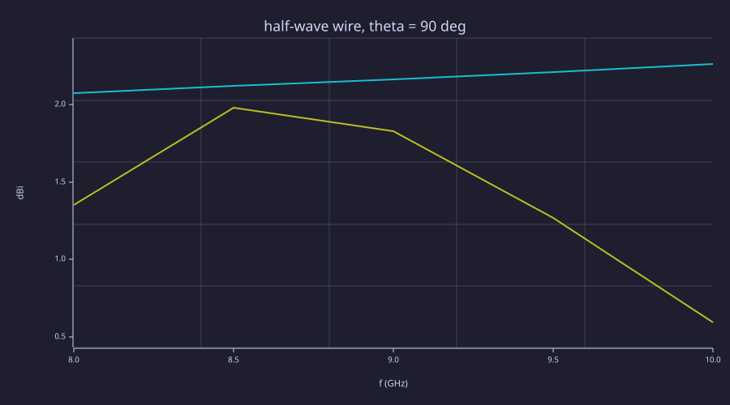

<!-- Generated by rustlab-notebook — do not edit directly. -->

# Near-to-far: a short dipole and a half-wave wire

`fdtd_ntff` records the tangential `E` and `H` on one closed box while the grid steps. `fdtd_farfield` turns that record into `Etheta` and `Ephi`.

A z-directed electric current radiates `Etheta`. In the xy plane that is the co-polar component. `Ephi` is the cross-polar one, and for this dipole it is numerical noise. The phasors include `dt`, so they are in V·s, and the spherical factor `e^{-jkr}/r` is left off.

Three different quotients:

- **Directivity** divides the radiation intensity by the power that left through the box, `4π U / Pflux`.
- **Gain** divides by the power the port accepted, `½ Re(V conj(I))`.
- **Realized gain** divides by the incident power `½ |a|²`.

With no port, gain and realized gain are `NaN`. They are also `NaN` when that power is not positive. `realized_gain = gain · (1 − |S11|²)` is how those two are defined. It is not a check that the pattern is right, and it is not `directivity · (1 − |S11|²)` once the grid has loss.

v1 is a box in air, inside CPML on all six faces. The cells outside the box, and one cell inside it, are one lossless medium. A source, a port, or metal on that layer is an error. Each frequency needs at least ten cells per background wavelength. A ground, a substrate, and image theory are Phase 6. That geometry is not decided, and this notebook does not pick one.

The default `"decay", "pulse"` refuses the pattern when the last tenth of the surface field, or of the port voltage or current, is still above `1e-3` of its peak. A tone that never dies is not a far field of a pulse.

`abs` treats a value whose imaginary part is below `1e-10` as real. The far-field phasor is a few times `1e-14`, so it is scaled by `1e12` before `abs`. The current moment is even smaller, about `1e-17`, so its magnitude and phase come from the spectrum of the driving samples, which is order 1. A one-element tensor index snaps below `1e-12` as well, so the cuts ask for more than one angle.

```rustlab
c0 = 299792458;
dx = 1e-3;
mu0 = 1.25663706212e-6;
eps0 = 1 / (mu0 * c0 * c0);
eta0 = sqrt(mu0 / eps0);

n = 32;
sim = fdtd3d(n, n, n, dx, dx, dx, "courant", 0.99);
fdtd_cpml(sim, 6);
info = fdtd_info(sim);
dt = info.dt;
nsteps = 700;
fc = c0 / 0.020;
tau = sqrt(2) / (2 * pi * fc);
t0 = 5 * tau;
s = 1:nsteps;
u = (s * dt - t0) / tau;
g = -u .* exp(-u .* u);
ic = n / 2 + 1;
fdtd_source(sim, "ez", ic, ic, ic, "soft", g);
f = c0 / 0.030;
fdtd_ntff(sim, f);
fdtd_run(sim, nsteps);

org = [16e-3, 16e-3, 16.5e-3];
th = (1:35) * pi / 36;
pat = fdtd_farfield(sim, th, 0, "origin", org);
k = 2 * pi * f / c0;
spec = sum(g .* exp(-j * 2 * pi * f * (s - 0.5) * dt));
il = abs(spec) * dt * dx * dx;
fan = eta0 * k * il / (4 * pi);
eth = pat.Etheta(1, :, 1) * 1e12;
ae = abs(eth) / 1e12;
a90 = ae(18);
amp = abs(a90 / fan - 1);
ph = abs(angle(eth)(18) - angle(spec) - pi / 2);
shape = max(abs(ae ./ (abs(fan) * sin(th)) - 1));
d = pat.directivity(1, :, 1);
d90 = d(18);
ddb = pat.directivity_dBi(1, :, 1);
pan = eta0 * k^2 * il^2 / (12 * pi);
pr = abs(pat.prad(1) / pan - 1);
fprintf("short dipole  |F/Fan|-1 = %.4f   phase = %.4f rad\n", amp, ph);
fprintf("              shape = %.4f   D(90) = %.4f (%.3f dBi)   |P/Pan|-1 = %.4f\n", shape, d90, ddb(18), pr);
if amp > 0.01
    error("short-dipole amplitude left the 1% band");
end
if ph > 0.02
    error("short-dipole phase left the 0.02 rad band");
end
if shape > 0.01
    error("short-dipole sin(theta) shape left the 1% band");
end
if abs(d90 / 1.5 - 1) > 0.01
    error("short-dipole peak directivity left the 1% band");
end
if pr > 0.01
    error("short-dipole flux left the 1% band");
end

phic = linspace(0, 2 * pi, 73);
phic = phic(1:end - 1);
cut = fdtd_farfield(sim, pi / 2, phic, "origin", org);
xe = abs(cut.Ephi(1, 1, :) * 1e12);
ye = abs(cut.Etheta(1, 1, :) * 1e12);
xpol = max(xe ./ ye);
fprintf("              max |Ephi|/|Etheta| on the xy cut = %.3e\n", xpol);
if xpol > 2e-5
    error("short-dipole cross-pol left the 2e-5 band");
end

subplot(2, 1, 1);
plot(th * 180 / pi, ae / a90, th * 180 / pi, sin(th));
xlabel("theta (deg)");
ylabel("|Etheta| / max");
title("short dipole elevation");

subplot(2, 1, 2);
ring = abs(cut.Etheta(1, 1, :) * 1e12);
polar(phic, ring / max(ring));
title("short dipole, theta = 90 deg");
```

<!-- rustlab:output-start -->
```text
short dipole  |F/Fan|-1 = 0.0040   phase = 0.0009 rad
              shape = 0.0040   D(90) = 1.5044 (1.774 dBi)   |P/Pan|-1 = 0.0050
              max |Ephi|/|Etheta| on the xy cut = 2.399e-06
```



<!-- rustlab:output-end -->

The elevation trace should follow `sin(theta)`. `D(90°)` is about 1.50, which is 1.76 dBi. The analytic current moment uses the same half-step as the surface current.

The wire below is a centre-fed dipole, not a patch. Two PEC sheets on the plane through the port leave one `ez` edge as the gap. CPML is eight cells on every face, so the box has air around the metal. The only `error` on this part is the power balance: accepted power and the flux through the box agree to 0.1%. The printed `Zin` and the dBi numbers are the measurement, not a tighter gate.

```rustlab
nw = 48;
wire = fdtd3d(nw, nw, nw, dx, dx, dx, "courant", 0.99);
fdtd_cpml(wire, 8);
winfo = fdtd_info(wire);
wsteps = 1000;
wfc = 9e9;
wtau = sqrt(2) / (2 * pi * wfc);
wt0 = 5 * wtau;
ws = 1:wsteps;
wu = (ws * winfo.dt - wt0) / wtau;
gw = -wu .* exp(-wu .* wu);
jc = nw / 2 + 1;
kc = jc;
mlo = zeros(nw, nw);
mlo(jc, (kc - 7):kc) = 1;
fdtd_pec(wire, "x", jc, mlo);
mhi = zeros(nw, nw);
mhi(jc, (kc + 1):(kc + 8)) = 1;
fdtd_pec(wire, "x", jc, mhi);
fdtd_port(wire, "ez", jc, jc, kc, 50, gw);
fw = 8e9:0.5e9:10e9;
fdtd_ntff(wire, fw);
fdtd_run(wire, wsteps);
wp = fdtd_farfield(wire, [pi / 2, pi / 2], 0);
fprintf("f (GHz)    Re Zin    Im Zin    |S11|    D dBi    G dBi    Gr dBi\n");
for q = 1:length(fw)
    v = wp.s11(q);
    zin = 50 * (1 + v) / (1 - v);
    fprintf("%6.1f   %8.2f  %8.2f   %6.4f   %6.3f   %6.3f   %6.3f\n", fw(q) / 1e9, real(zin), imag(zin), abs(v), wp.directivity_dBi(q, 1, 1), wp.gain_dBi(q, 1, 1), wp.realized_gain_dBi(q, 1, 1));
end
bal = max(abs(wp.paccepted ./ wp.prad - 1));
fprintf("max |Pacc/Pflux - 1| = %.3e\n", bal);
if bal > 1e-3
    error("wire dipole accepted power left the flux by more than 0.1%");
end

clf;
plot(fw / 1e9, wp.gain_dBi(:, 1, 1), fw / 1e9, wp.realized_gain_dBi(:, 1, 1));
xlabel("f (GHz)");
ylabel("dBi");
title("half-wave wire, theta = 90 deg");
```

<!-- rustlab:output-start -->
```text
f (GHz)    Re Zin    Im Zin    |S11|    D dBi    G dBi    Gr dBi
   8.0      55.37    -44.61   0.3927    2.077    2.077    1.350
   8.5      66.74    -12.20   0.1765    2.120    2.120    1.983
   9.0      80.32     19.35   0.2730    2.165    2.165    1.829
   9.5      96.60     50.25   0.4422    2.212    2.212    1.267
  10.0     116.20     80.55   0.5645    2.261    2.261    0.595
max |Pacc/Pflux - 1| = 3.225e-06
```



<!-- rustlab:output-end -->
