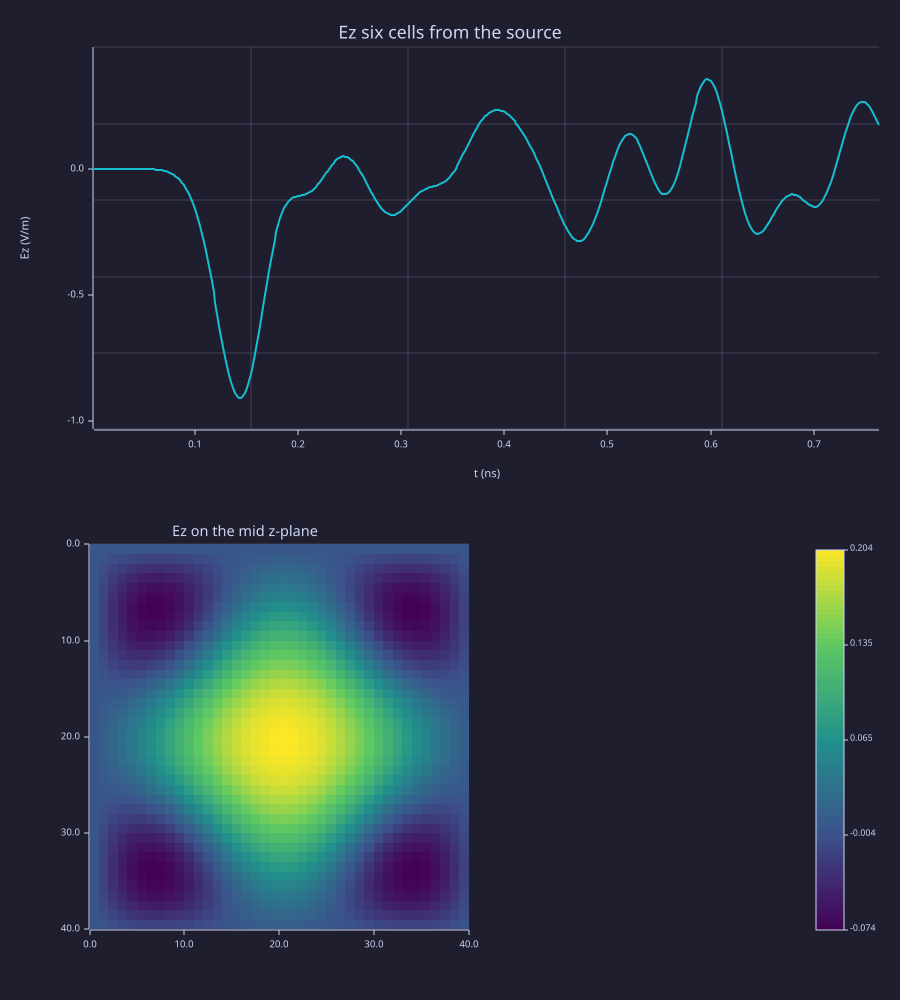

<!-- Generated by rustlab-notebook — do not edit directly. -->

# Hello FDTD — a pulse in a vacuum box

`fdtd3d` is a native 3-D finite-difference time-domain (Yee) stepper. With
no materials it is vacuum inside perfectly conducting (PEC) walls. Each
step updates the magnetic field from the curl of $\mathbf{E}$, then the
electric field from the curl of $\mathbf{H}$:

$$\mu_0 \frac{\partial \mathbf{H}}{\partial t} = -\nabla \times \mathbf{E}, \qquad
\varepsilon_0 \frac{\partial \mathbf{E}}{\partial t} = \nabla \times \mathbf{H} - \mathbf{J}.$$

The time step comes from the Courant (CFL) limit,
$\Delta t = s / \left(c_0 \sqrt{1/\Delta x^2 + 1/\Delta y^2 + 1/\Delta z^2}\right)$
with $s = 0.99$ by default. A Courant number above 1 is refused when the
grid is built, so no run can blow up.

This page drives one $E_z$ edge at the centre of a 40 × 40 × 40 box of
1 mm cells and records $E_z$ six cells away. Indices are 1-based
$(i, j, k)$ = (y row, x column, z page), the same order as a `Tensor3`.

A soft source is a current $J$. A plain Gaussian current would leave
charge behind on the edge (its time integral is not zero), and a static
field around the source would swamp the picture. The derivative of a
Gaussian integrates to zero, so the source is that, sampled once per
step from `gaussian_pulse`.

```rustlab
clf
n = 40;
dx = 1.0e-3;                            # 1 mm cells
sim = fdtd3d(n, n, n, dx, dx, dx);
info = fdtd_info(sim);                  # dt from the CFL limit, Courant 0.99

# ── Source: soft derivative-of-Gaussian current on Ez at the centre ──
# A soft source is a current. A plain Gaussian current leaves charge on
# the edge (its time integral is not zero) and a static field around it.
# The derivative of a Gaussian integrates to zero, so the box rings clean.
nsteps = 400;
tau = 20 * info.dt;                     # c0 * tau is about 11 cells
t0 = 4 * tau;
ts = (1:nsteps) * info.dt;              # sample n drives step n (time n*dt)
w = -(ts - t0) / tau .* gaussian_pulse(ts, t0, tau);
ic = n / 2 + 1;
fdtd_source(sim, "ez", ic, ic, ic, "soft", w);

# ── Probe: same row and page, six cells toward +x ───────────────
id = fdtd_probe(sim, "ez", ic, ic + 6, ic);

# ── Run long enough for the pulse to hit a wall and come back ───
out = fdtd_run(sim, nsteps);
t = out.t;                              # 1 × steps, sample n at n*dt
ez = out.probe(:, id);                  # out.probe is steps × nprobes

fprintf("%d steps of %.3g ps\n", out.steps, info.dt * 1e12);   # out.cell_rate: cell updates per second
[pk, at] = max(abs(ez));
fprintf("probe peak |Ez| = %.4g at t = %.3f ns\n", pk, t(at) * 1e9);

subplot(2, 1, 1);
plot(t * 1e9, ez);
xlabel("t (ns)");
ylabel("Ez (V/m)");
title("Ez six cells from the source");
subplot(2, 1, 2);
imagesc(fdtd_slice(sim, "ez", "z", ic));
title("Ez on the mid z-plane");
```

<!-- rustlab:output-start -->
```text
400 steps of 1.91 ps
probe peak |Ez| = 0.9066 at t = 0.145 ns
```



<!-- rustlab:output-end -->

The first lobe of the trace is the pulse passing the probe. What follows
is the same pulse coming back from the PEC walls, which reflect
everything; an absorbing boundary (CPML) is a later phase. The lower
panel is $E_z$ on the z-page through the source after the last step.

`fdtd_run` also returns `seconds`, `cell_updates`, and `cell_rate` (cell
updates per second). Pressing Ctrl+C during a long run stops it after
the step in progress and returns the record so far, with
`out.interrupted` set to `true`.
