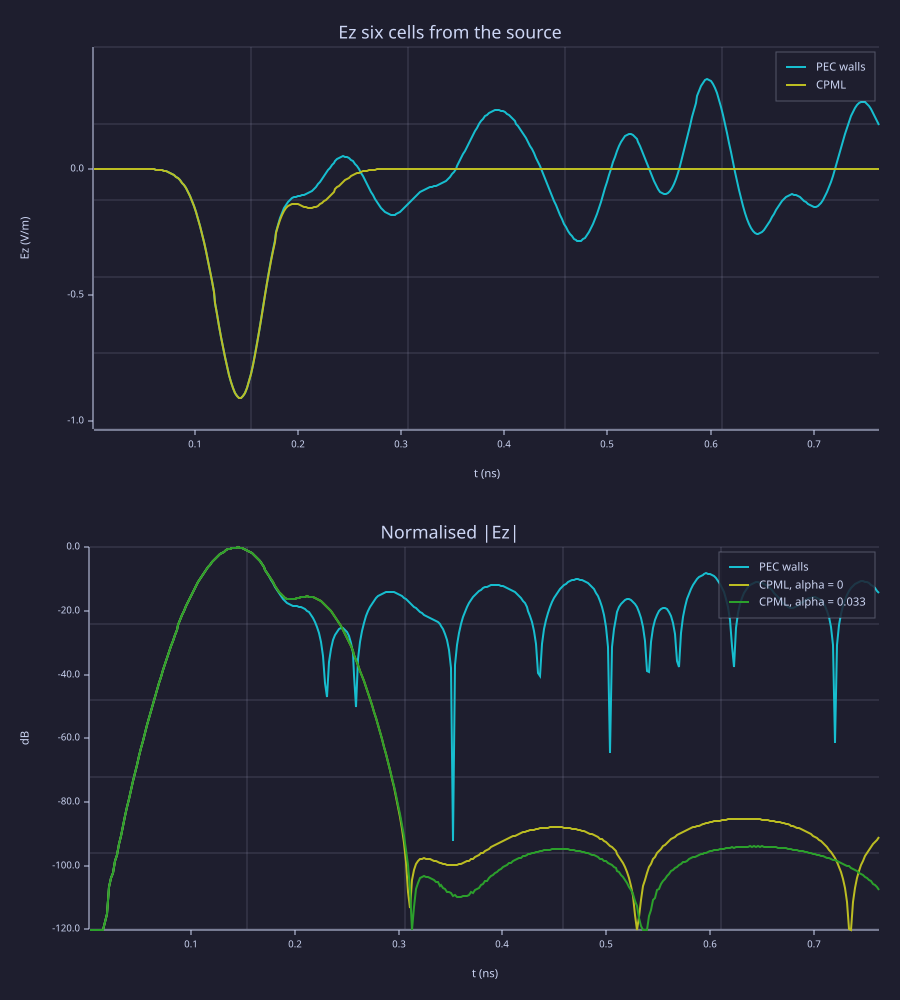

<!-- Generated by rustlab-notebook — do not edit directly. -->

# CPML — a pulse leaves the box

A Yee grid keeps a perfectly conducting wall on its outside. A wave
that reaches that wall comes back. A convolutional PML (CPML) is a few
cells of graded conductivity just inside the wall. The stretch that
the curl sees is

$$s = \kappa + \frac{\sigma}{\alpha + j\omega\varepsilon_0}.$$

For $\omega \gg \alpha/\varepsilon_0$ this is the ordinary PML stretch.
For $\omega \ll \alpha/\varepsilon_0$ it becomes real, so the layer
stops absorbing there. Each Cartesian derivative in the curl carries
one auxiliary. With $b = \exp(-(\sigma/\kappa + \alpha)\,\Delta t/\varepsilon_0)$
and $a = \sigma\,(b-1) / (\kappa(\sigma + \kappa\alpha))$ (and $a = 0$
when $\sigma = 0$),

$$\psi \;:=\; b\,\psi + a\,\frac{\Delta u}{\Delta}, \qquad
\frac{\partial u}{\partial x}\Big|_{\text{stretched}}
\approx \frac{\Delta u}{\kappa\,\Delta} + \psi.$$

`fdtd_cpml(sim, n)` puts `n` cells on all six faces. The face names are
`xmin`, `xmax`, `ymin`, `ymax`, `zmin`, `zmax`, in that order in
`fdtd_info(sim).cpml`. `fdtd_cpml(sim, "zmin", 0)` turns one face off,
and that side is a plain PEC wall again. The value that turns a face
back on has to be the same thickness.

> [!NOTE]
> The outer wall stays PEC. CPML damps the wave before it gets there.
> Conductivity in the slab uses vacuum $\varepsilon_0$ and that axis's
> $\Delta$, and is not scaled by $\varepsilon_r$.

## One pulse, three boxes

The source is the same zero-mean derivative of a Gaussian that
`fdtd_hello` uses, so it does not leave a static charge. The probe is
six cells toward $+x$. `n_left` is the first sample after the direct
pulse has passed that probe. The late residual is
$20\log_{10}$ of the late peak over the whole-trace peak.

`alpha_max` defaults to 0. The third run sets it to
$2\pi\varepsilon_0 \times 0.6\,\text{GHz}$, about 0.033 S/m. The pulse
spectrum peaks near 5.9 GHz, so 0.6 GHz is a decade below the band
that carries the energy. At 5.9 GHz, $\omega\varepsilon_0$ is about
ten times this $\alpha$. Below 0.6 GHz the wavelength is over 500 mm
against a 40 mm box, so what is left is near-field coupling, not a
travelling wave. $\alpha(\rho) = \alpha_{\max}(1-\rho)$ is largest at
the inner interface and 0 at the wall. With $\sigma_{\max} \approx 10.6$
S/m, $\sigma$ exceeds $\alpha_{\max}$ from about the second cell in.

```rustlab
n = 40;
dx = 1.0e-3;
nsteps = 400;

function ez = pml_run(n, dx, nsteps, npml, alpha)
  sim = fdtd3d(n, n, n, dx, dx, dx);
  if npml > 0
    fdtd_cpml(sim, npml, "alpha_max", alpha);
  end
  info = fdtd_info(sim);
  tau = 20 * info.dt;
  t0 = 4 * tau;
  ts = (1:nsteps) * info.dt;
  w = -(ts - t0) / tau .* gaussian_pulse(ts, t0, tau);
  ic = n / 2 + 1;
  fdtd_source(sim, "ez", ic, ic, ic, "soft", w);
  id = fdtd_probe(sim, "ez", ic, ic + 6, ic);
  out = fdtd_run(sim, nsteps);
  ez = out.probe(:, id);
end

bare = fdtd3d(n, n, n, dx, dx, dx);
info = fdtd_info(bare);
dt = info.dt;
c0 = info.c0;
mu0 = 1.25663706212e-6;
eps0 = 1 / (mu0 * c0^2);
alpha = 2 * pi * eps0 * 0.6e9;

ez_pec = pml_run(n, dx, nsteps, 0, 0);
ez_cpml = pml_run(n, dx, nsteps, 8, 0);
ez_alpha = pml_run(n, dx, nsteps, 8, alpha);

n_left = ceil(8 * 20 + 6 * dx / (c0 * dt));
t = (1:nsteps) * dt;

function db = late_db(ez, n_left)
  db = 20 * log10(max(abs(ez(n_left:end))) / max(abs(ez)));
end

db_pec = late_db(ez_pec, n_left);
db_cpml = late_db(ez_cpml, n_left);
db_alpha = late_db(ez_alpha, n_left);

fprintf("late residual, PEC walls:        %6.1f dB\n", db_pec);
fprintf("late residual, CPML alpha = 0:   %6.1f dB\n", db_cpml);
fprintf("late residual, CPML alpha = %.3f: %6.1f dB\n", alpha, db_alpha);

if db_cpml > -40
  error(sprintf("CPML late residual %.1f dB is above -40 dB", db_cpml));
end

subplot(2, 1, 1);
plot(t * 1e9, ez_pec, t * 1e9, ez_cpml);
xlabel("t (ns)");
ylabel("Ez (V/m)");
title("Ez six cells from the source");
legend("PEC walls", "CPML");
subplot(2, 1, 2);
plot(t * 1e9, mag2db(ez_pec / max(abs(ez_pec))), ...
     t * 1e9, mag2db(ez_cpml / max(abs(ez_cpml))), ...
     t * 1e9, mag2db(ez_alpha / max(abs(ez_alpha))));
xlabel("t (ns)");
ylabel("dB");
title("Normalised |Ez|");
legend("PEC walls", "CPML, alpha = 0", "CPML, alpha = 0.033");
ylim([-120, 0]);
```

<!-- rustlab:output-start -->
```text
late residual, PEC walls:          -8.2 dB
late residual, CPML alpha = 0:    -85.2 dB
late residual, CPML alpha = 0.033:  -93.9 dB
```



<!-- rustlab:output-end -->

The late residuals, in dB down from each run's own peak:

| Box | Late residual |
|---|---|
| PEC walls | -8.2 dB |
| CPML, $\alpha = 0$ | -85.2 dB |
| CPML, $\alpha \approx 0.033$ S/m | -93.9 dB |

The $\alpha = 0$ trace is the gate: it has to stay under −40 dB. Turning
$\alpha$ on changes that number by a few dB and does not replace the
default. `alpha_max` stays 0 unless a script sets it.

```rustlab
sim = fdtd3d(20, 20, 20, 1e-3, 1e-3, 1e-3);
fdtd_cpml(sim, 4);
fdtd_info(sim).cpml
fdtd_cpml(sim, "zmin", 0);
fdtd_info(sim).cpml
```

<!-- rustlab:output-start -->
```text
[1×6]  4.000000  4.000000  4.000000  4.000000  4.000000  4.000000
[1×6]  4.000000  4.000000  4.000000  4.000000  0.000000  4.000000
```

<!-- rustlab:output-end -->

The first vector is `[4 4 4 4 4 4]`. After the second call the `zmin`
entry is 0 and the other five stay 4.

> [!NOTE]
> Try a thinner layer, `fdtd_cpml(sim, 4)`, and the same pulse with
> `"sigma_factor"` at 0.5 and at 2. A thinner layer lets more of the
> wave through to the wall. `sigma_factor` scales $\sigma_{\max}$ and
> does not change $\kappa$ or $\alpha$.
