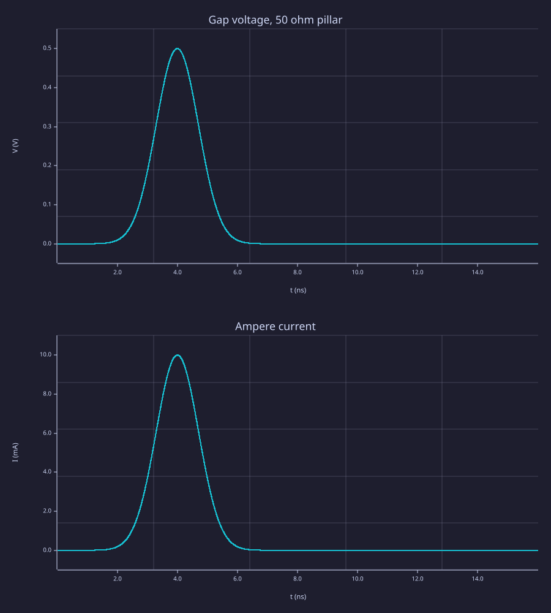
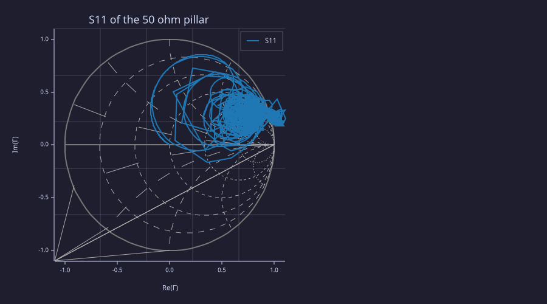
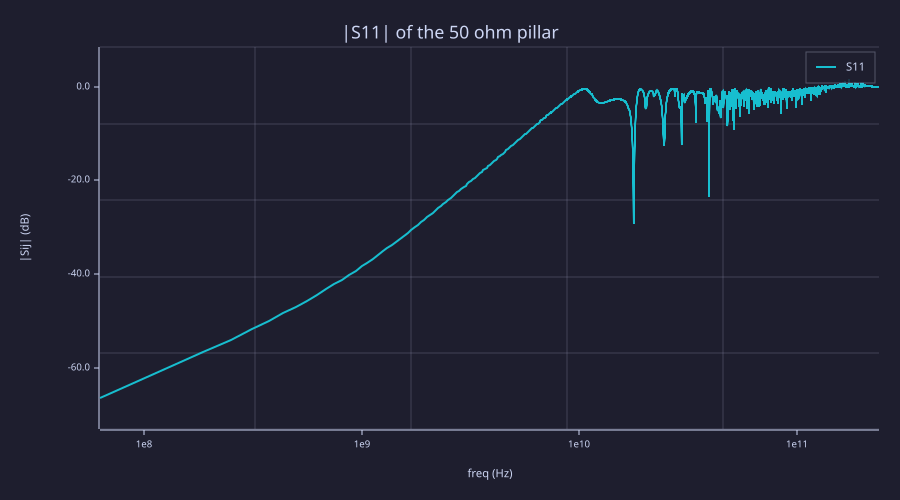

<!-- Generated by rustlab-notebook — do not edit directly. -->

# FDTD port — an independent resistor

A lumped port is a voltage source in series with `Z0`, on one edge of
the Yee grid. The resistor in this notebook is not that source
resistance. It is a pillar of conductive cells under a metal pad, one
node away from the port, so the port edges carry none of its
conductivity.

The pillar is `n×n` cells in cross-section and `kp` cells tall, with

$$\sigma = \frac{k_p\,\Delta z}{R\,n\,\Delta x\,n\,\Delta y}.$$

The edge bake takes an arithmetic mean. Interior edges count 1, side
edges ½ and corners ¼, and those weights sum to `n²`, so the DC
conductance is exactly `1/R`. `V/I` at the port is that resistance.
Solving the port's own update for `Z0` only restates the stamp, so it
is not the check.

`Δx` and `Δy` are different. The Ampère current uses the Yee segment
lengths, `ΔHy·Δy − ΔHx·Δx`. Swapping them misses `R`.

`fdtd_s11` applies no window unless you name one. A Hann window is the
right tool for a steady tone that fills the record. On a pulse it
weights the early incident wave and a later reflection differently, so
the ratio is not `b/a`. `"nfft", M` zero-pads to `M` samples. The new
bins interpolate the DFT of the record in hand. They do not resolve
tones closer than `1/(NΔt)`; a longer record is what does that.
`fdtd_s11(sim)` also refuses a pulse whose last 10% is still above
`1e-3` of the peak. `fdtd_s11(V, I, dt, Z0)` is the synthetic form and
does not apply that check unless you pass `"decay", "pulse"`.

```rustlab
dx = 1.0e-3;
dy = 1.5e-3;
dz = 1.0e-3;
z0 = 50;
n = 4;
kp = 2;
ip = 6;
jp = 8;
tau = 1e-9;

function [vi, s_real, s_abs, V, I, t, net] = one_load(rload, dx, dy, dz, z0, n, kp, ip, jp, tau)
  sim = fdtd3d(16, 14, 8, dx, dy, dz);
  sig = zeros3(14, 16, 8);
  sig(ip:ip + n - 1, jp:jp + n - 1, 1:kp) = kp * dz / (rload * n * dx * n * dy);
  fdtd_media(sim, 1, 1, sig);
  pad = zeros(14, 16);
  pad(ip:ip + n, jp - 1:jp + n) = 1;
  fdtd_pec(sim, "z", kp + 1, pad);
  fdtd_port(sim, "ez", ip + n / 2, jp - 1, 1:kp, z0, "gaussian", 4 * tau, tau);
  dt = fdtd_info(sim).dt;
  out = fdtd_run(sim, round(16 * tau / dt));
  V = out.V;
  I = out.I;
  t = (1:out.steps) * out.dt;
  at = argmax(abs(I));
  vi = V(at) / I(at);
  net = fdtd_s11(sim);
  f = net.frequencies;
  tone = sij(net, 1, 1);
  mag = abs(tone);
  keep = and(mag == mag, f <= 300e6);
  s_abs = max(mag(keep));
  ks = find(keep);
  s_real = real(tone(ks(1)));
end

for rload = [25, 50, 100]
  [vi, s_real, s_abs, V, I, t, net] = one_load(rload, dx, dy, dz, z0, n, kp, ip, jp, tau);
  fprintf("R = %6.1f ohm   V/I = %8.4f ohm (%+.3f%%)   S11(first bin) = %+.4f   max |S11| to 300 MHz = %.4f\n", ...
          rload, vi, 100 * (vi / rload - 1), s_real, s_abs);
  if abs(vi / rload - 1) > 0.01
    error(sprintf("V/I is %.3f%% off R = %g (1%% gate)", 100 * (vi / rload - 1), rload));
  end
  if rload == z0 && s_abs > 0.01
    error(sprintf("matched |S11| = %.4f, want <= 0.01 up to 300 MHz", s_abs));
  end
  if rload < z0 && s_real >= 0
    error(sprintf("R = %g < Z0, but low-frequency S11 is %+.4f", rload, s_real));
  end
  if rload > z0 && s_real <= 0
    error(sprintf("R = %g > Z0, but low-frequency S11 is %+.4f", rload, s_real));
  end
  if rload == z0
    matched_v = V;
    matched_i = I;
    matched_t = t;
    matched_net = net;
    matched_vi = vi;
    matched_s = s_abs;
    matched_err = abs(vi / rload - 1);
  end
end
```

<!-- rustlab:output-start -->
```text
R =   25.0 ohm   V/I =  25.0005 ohm (+0.002%)   S11(first bin) = -0.3333   max |S11| to 300 MHz = 0.3339
R =   50.0 ohm   V/I =  49.9579 ohm (-0.084%)   S11(first bin) = -0.0000   max |S11| to 300 MHz = 0.0020
R =  100.0 ohm   V/I =  99.5866 ohm (-0.413%)   S11(first bin) = +0.3332   max |S11| to 300 MHz = 0.3333
```

<!-- rustlab:output-end -->

On this run the 50 ohm pillar reads 49.958 ohm at the
current peak, 8.429e-04 relative to 50 ohm. The largest
$|S_{11}|$ up to 300 MHz is 0.0020.

```rustlab
subplot(2, 1, 1);
plot(matched_t * 1e9, matched_v);
xlabel("t (ns)");
ylabel("V (V)");
title("Gap voltage, 50 ohm pillar");
subplot(2, 1, 2);
plot(matched_t * 1e9, matched_i * 1e3);
xlabel("t (ns)");
ylabel("I (mA)");
title("Ampere current");
```

<!-- rustlab:output-start -->


<!-- rustlab:output-end -->

```rustlab
clf
smith(matched_net);
title("S11 of the 50 ohm pillar");
```

<!-- rustlab:output-start -->


<!-- rustlab:output-end -->

```rustlab
clf
rfplot(matched_net);
title("|S11| of the 50 ohm pillar");
```

<!-- rustlab:output-start -->


<!-- rustlab:output-end -->

> [!NOTE]
> The chart is the default `fdtd_s11(sim)`: no window, and no zero
> padding. A matched pillar sits near the centre of the Smith chart.
> `"window", "hann"` is for a steady tone. `"nfft", M` only interpolates.
