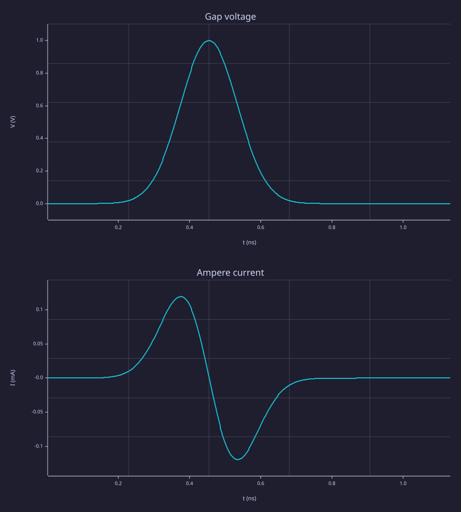
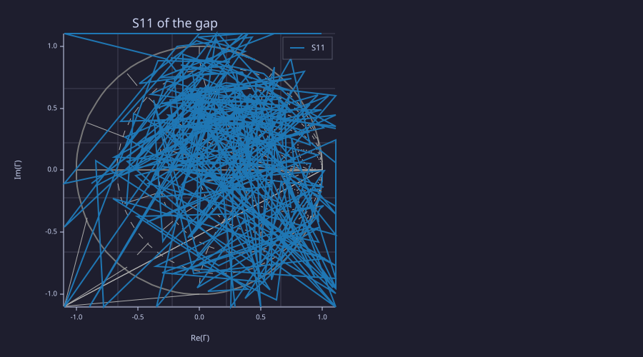
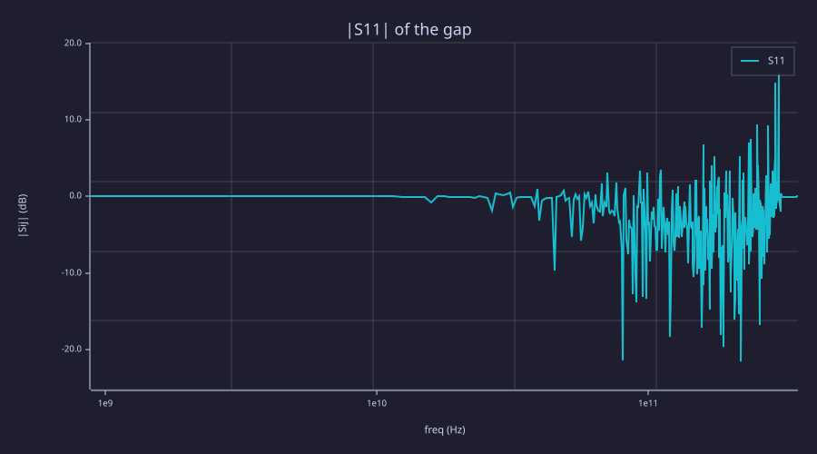

<!-- Generated by rustlab-notebook — do not edit directly. -->

# FDTD port — a resistor in series with one gap

A lumped port is a voltage source in series with a resistor, sitting on
one edge of the Yee grid. The resistor is not a separate component. It
is extra conductivity on that edge,

$$\sigma = \frac{\Delta z}{Z_0\,\Delta x\,\Delta y},$$

baked into the same $C_a$ and $C_b$ a material conductivity uses. The
source then subtracts

$$\frac{\Delta t}{\varepsilon_0}\,C_b\,\frac{V_g}{Z_0\,\mathrm{Area}}$$

from $E_z$. An impressed field $E_z \mathrel{-}= C_b\,V_g/(N\Delta z)$
is the existing soft source. It does not put $V_g$ in series with
$Z_0$, so the port does not use it.

The gap voltage is $V = -E_z\Delta z$, taken after the E update. The
current is the Ampère loop around the edge, with the segment lengths
of the curl ($\Delta H_y$ is multiplied by $\Delta y$, $\Delta H_x$ by
$\Delta x$). $I$ is the half-step sample. `fdtd_s11` multiplies its
spectrum by $e^{+j\omega\Delta t/2}$ so both phasors sit at the integer
time of $V$, then

$$a = \frac{V + Z_0 I}{2\sqrt{Z_0}}, \qquad
b = \frac{V - Z_0 I}{2\sqrt{Z_0}}, \qquad
S_{11} = b/a.$$

The return value is a 1-port `sparameters` network, which `smith` and
`rfplot` already accept. v1 has one port. A second `fdtd_port` errors
and names the deferred S21 phase.

## What the 1% check is

The lossy update on that edge is the recurrence

$$V^{n} = C_a V^{n-1} + \beta\,(V_g - Z_0 I^{n}),$$

with $s = \sigma\Delta t/(2\varepsilon_0)$, $C_a = (1-s)/(1+s)$ and
$\beta = 2s/(1+s)$. Solving it for $Z_0$ recovers the resistance the
port enforces. $V/I$ is a different number: it is the impedance of the
grid beyond the gap. This box is a small PEC cavity, not a 50 ohm
load, so $|S_{11}|$ on the chart is the reflection of that cavity.
$\Delta x$ and $\Delta y$ are different, so a loop that swaps those
two lengths does not recover 50 ohm.

```rustlab
dx = 1.0e-3;
dy = 1.5e-3;
dz = 0.5e-3;
z0 = 50;
sim = fdtd3d(12, 10, 10, dx, dy, dz);
info = fdtd_info(sim);
dt = info.dt;
mu0 = 1.25663706212e-6;
eps0 = 1 / (mu0 * info.c0^2);
tau = 80 * dt;
t0 = 4 * tau;
fdtd_port(sim, "ez", 5, 5, 5, z0, "gaussian", t0, tau);
out = fdtd_run(sim, 800);

V = out.V;
I = out.I;
n = out.steps;
t = (1:n) * dt;
vg = gaussian_pulse(t, t0, tau);

sigma = dz / (z0 * dx * dy);
s = sigma * dt / (2 * eps0);
ca = (1 - s) / (1 + s);
beta = 2 * s / (1 + s);
peak = max(abs(I));

# The update is a recurrence in V, so each sample uses the one before it.
worst = 0;
power = 0;
npow = 0;
for k = 2:n
  if abs(I(k)) >= 0.2 * peak
    zk = (vg(k) - (V(k) - ca * V(k - 1)) / beta) / I(k);
    err = abs(zk / z0 - 1);
    if err > worst
      worst = err;
    end
    if t(k) < t0
      power = power + V(k) * I(k);
      npow = npow + 1;
    end
  end
end
power = power / npow;

net = fdtd_s11(sim, "window", "rect");
from_samples = fdtd_s11(V, I, dt, z0, "window", "rect");
if max(abs(sij(net, 1, 1) - sij(from_samples, 1, 1))) != 0
  error("fdtd_s11(sim) and fdtd_s11(V, I, dt, Z0) disagree");
end

f = net.frequencies;
mag = abs(sij(net, 1, 1));
finite = mag == mag;
band = and(finite, and(f > 0.05 / tau, f < 2 / tau));
gb = mag(band);
fb = f(band);
at = argmin(gb);
gb_at = gb(at);
fb_ghz = fb(at) / 1e9;

fprintf("recovered Z0                 %.6f ohm\n", z0);
fprintf("worst relative error         %.3e\n", worst);
fprintf("mean V*I while rising        %.3e W\n", power);
fprintf("smallest |S11| in the band   %.3f at %.3f GHz\n", gb_at, fb_ghz);

if worst > 0.01
  error(sprintf("recovered resistance is %.3e relative to Z0 (1%% gate)", worst));
end
if power <= 0
  error("V*I on the rise is not into the grid");
end
```

<!-- rustlab:output-start -->
```text
recovered Z0                 50.000000 ohm
worst relative error         2.917e-13
mean V*I while rising        4.161e-05 W
smallest |S11| in the band   0.912 at 15.898 GHz
```

<!-- rustlab:output-end -->

On this run the recovered resistance is off by 2.917e-13 relative
to 50 ohm. The mean $VI$ while the Gaussian is still rising is
4.161e-05 W (positive means power into the grid). The smallest
$|S_{11}|$ in the pulse band is 0.912 at 15.898 GHz.

`out.V` and `out.I` are `steps × 1`. `out.Z0` is the port resistance.
`fdtd_s11` drops DC, because `rfplot` draws a logarithmic frequency
axis.

```rustlab
subplot(2, 1, 1);
plot(t * 1e9, V);
xlabel("t (ns)");
ylabel("V (V)");
title("Gap voltage");
subplot(2, 1, 2);
plot(t * 1e9, I * 1e3);
xlabel("t (ns)");
ylabel("I (mA)");
title("Ampere current");
```

<!-- rustlab:output-start -->


<!-- rustlab:output-end -->

```rustlab
clf
smith(net);
title("S11 of the gap");
```

<!-- rustlab:output-start -->


<!-- rustlab:output-end -->

```rustlab
clf
rfplot(net);
title("|S11| of the gap");
```

<!-- rustlab:output-start -->


<!-- rustlab:output-end -->

> [!NOTE]
> A rectangular window leaves the long tail of the Gaussian in the
> transform. Hann is the default, and it would taper that tail. The
> same network is what `fdtd_s11(sim)` returns when the grid has one
> port.
