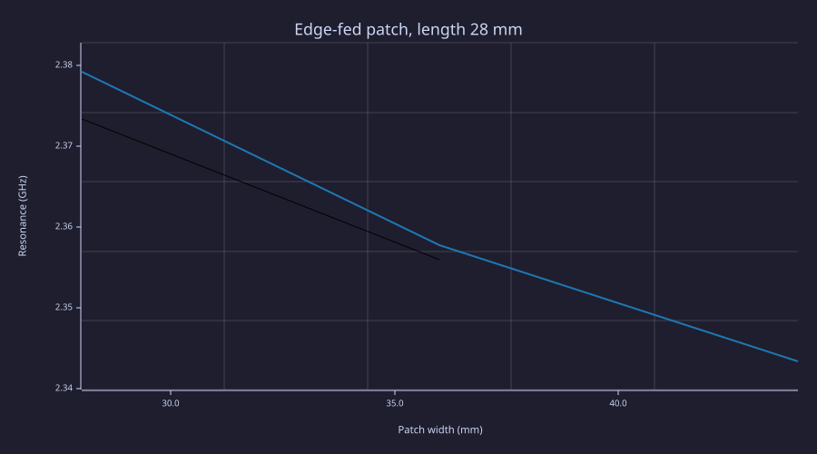

<!-- Generated by rustlab-notebook — do not edit directly. -->

# Patch width sweep

Patch widths from 28 mm to 44 mm on one ground. The length stays 28 mm. `parmap` builds a grid per width and steps it.

The resonance and the match should both fall as the patch gets wider. Each resonance should stay within 1.5% of the staircased transmission-line model, and the span of the resonances should be between half and twice the span of that model.

## Presets

The `preset` line near the top of the cell picks the run. Both records are about 18 ns, which is where the widest patch passes the $10^{-3}$ pulse check in `fdtd_s11`. The narrow and the middle patch have decayed long before that.

| preset | substrate cells | steps | widths | stepping |
|---|---:|---:|---|---|
| `quick` (default) | 1 | 5,000 | 28, 36, 44 mm | `"threads", 1`: one core per trial |
| `full` | 2 | 8,000 | 28 to 44 mm, step 4 mm | shared pool |

The quick sweep takes about ten seconds on four cores, and its 36 mm trial prints the same dip as the quick patch notebook. Edit the line to `preset = "full";` for five widths on the two-cell substrate, about three and a half times as long.

The `"threads"` choice is the lesson in parallel stepping. With three trials on four cores, each trial on its own core is faster than three trials sharing the pool: 9.7 s against 12.4 s on the machine that measured it, with bit-identical results. With five trials, more than the cores, the full preset steps on the shared pool so no core sits idle once the first trials finish.

```rustlab
# Patch width sweep on the 2 mm mesh.
# Demonstrates: parmap over an fdtd3d builder. Each trial builds its own
# grid and steps it with the preset's "threads" value: 1 keeps a trial on
# one core, 0 steps it on the shared rayon pool.
#
# preset is "quick" or "full". quick is the default: one cell through the
# 1.6 mm substrate, 5 000 steps, three widths (28:8:44 mm), one core per
# trial. full is two cells through the substrate, 8 000 steps, five widths
# (28:4:44 mm) on the shared pool, about three times the run time. Both
# records are about 18 ns, long enough for the widest patch to pass the
# 1e-3 pulse check in fdtd_s11.
#
# The ground and the mesh stay the size of the 38 mm design. Only the
# patch width changes, and the length stays 28 mm. NTFF is off: the
# result is the resonance and the match, not the pattern.

preset = "quick";

function m = sweep_preset(name)
    switch name
        case "quick"
            m = struct("nsub", 1, "nsteps", 5000, "widths", 28e-3:8e-3:44e-3, "threads", 1);
        case "full"
            m = struct("nsub", 2, "nsteps", 8000, "widths", 28e-3:4e-3:44e-3, "threads", 0);
        otherwise
            error(sprintf("unknown preset %s: use quick or full", name));
    end
end

function r = patch_res(Wm, nsub, nsteps, threads)
    eps_r = 4.4;
    h = 1.6e-3;
    f0 = 2.4e9;
    Lm = 28e-3;
    dx = 2e-3;
    dz = h / nsub;
    npml = 8;
    margin = 2;
    ngx = 2 * round((Lm / 2 + 16e-3) / dx);
    ngy = 2 * round((19e-3 + 16e-3) / dx);
    nax = round(10e-3 / dx);
    naz = round(20e-3 / dz);
    nx = ngx + 2 * (npml + margin + nax);
    ny = ngy + 2 * (npml + margin + nax);
    nz = nsub + 2 * (npml + margin + naz);
    jg0 = npml + margin + nax;
    ig0 = jg0;
    kg = npml + margin + naz;
    sim = fdtd3d(nx, ny, nz, dx, dx, dz, "threads", threads);
    eps = ones3(ny, nx, nz);
    eps(ig0 + 1:ig0 + ngy, jg0 + 1:jg0 + ngx, kg + 1:kg + nsub) = eps_r;
    fdtd_media(sim, eps, 1, 0);
    fdtd_cpml(sim, npml);
    ground = zeros(ny, nx);
    ground(ig0 + 1:ig0 + ngy + 1, jg0 + 1:jg0 + ngx + 1) = 1;
    fdtd_pec(sim, "z", kg + 1, ground);
    nL = round(Lm / dx);
    nW = round(Wm / dx);
    if nW != 2 * round(nW / 2)
        error("width is an odd number of cells");
    end
    j0 = nx / 2 - nL / 2;
    i0 = ny / 2 - nW / 2;
    patch = zeros(ny, nx);
    patch(i0 + 1:i0 + nW + 1, j0 + 1:j0 + nL + 1) = 1;
    fdtd_pec(sim, "z", kg + nsub + 1, patch);
    tau = 1 / (2 * f0);
    fdtd_port(sim, "ez", ny / 2 + 1, j0 + 1, kg + 1:kg + nsub, 50, "modulated", 4 * tau, tau, f0);
    fdtd_run(sim, nsteps);
    s = fdtd_s11(sim, "nfft", 8 * nsteps);
    f = s.frequencies;
    a = abs(sij(s, 1, 1));
    band = find(and(f > 1.8e9, f < 3.2e9));
    k = argmin(a(band));
    r = [f(band(k)), a(band(k))];
end

c0 = 299792458;
eps_r = 4.4;
h = 1.6e-3;
Lm = 28e-3;
dx = 2e-3;
m = sweep_preset(preset);
widths = m.widths;
nsub = m.nsub;
nsteps = m.nsteps;
threads = m.threads;
tic;
R = parmap(@(w) patch_res(w, nsub, nsteps, threads), widths);
fprintf("parmap over %d widths on %d threads: %.1f s\n", length(widths), nproc(), toc);

f_model = zeros(1, length(widths));
for q = 1:length(widths)
    w_eff = widths(q) + dx;
    ee = (eps_r + 1) / 2 + (eps_r - 1) / 2 / sqrt(1 + 12 * h / w_eff);
    dL = 0.412 * h * (ee + 0.3) * (w_eff / h + 0.264) / ((ee - 0.258) * (w_eff / h + 0.8));
    f_model(q) = c0 / (2 * (Lm + dx + 2 * dL) * sqrt(ee));
    fprintf("  W = %2.0f mm: f_res = %.4f GHz, model %.4f GHz, min |S11| = %.3f\n", ...
        widths(q) * 1e3, R(q, 1) / 1e9, f_model(q) / 1e9, R(q, 2));
end

if size(R, 1) != length(widths) || size(R, 2) != 2
    error("sweep result is not one row of [f_res, min |S11|] per width");
end
for q = 2:length(widths)
    if R(q, 1) >= R(q - 1, 1)
        error(sprintf("resonance did not fall at W = %.0f mm", widths(q) * 1e3));
    end
    if R(q, 2) >= R(q - 1, 2)
        error(sprintf("the match did not deepen at W = %.0f mm", widths(q) * 1e3));
    end
end
for q = 1:length(widths)
    if abs(R(q, 1) / f_model(q) - 1) > 0.015
        error(sprintf("W = %.0f mm is %.2f%% from the staircased TL model", ...
            widths(q) * 1e3, (R(q, 1) / f_model(q) - 1) * 100));
    end
end
span = R(1, 1) - R(end, 1);
model_span = f_model(1) - f_model(end);
ratio = span / model_span;
fprintf("span %.1f MHz, model %.1f MHz, ratio %.2f\n", span / 1e6, model_span / 1e6, ratio);
if ratio < 0.5 || ratio > 2
    error(sprintf("width sensitivity ratio %.2f is outside 0.5 to 2", ratio));
end

plot(widths * 1e3, R(:, 1) / 1e9, "b", widths * 1e3, f_model / 1e9, "k--");
xlabel("Patch width (mm)");
ylabel("Resonance (GHz)");
title("Edge-fed patch, length 28 mm");
```

<!-- rustlab:output-start -->
```text
parmap over 3 widths on 4 threads: 10.2 s
  W = 28 mm: f_res = 2.3791 GHz, model 2.3733 GHz, min |S11| = 0.728
  W = 36 mm: f_res = 2.3577 GHz, model 2.3559 GHz, min |S11| = 0.610
  W = 44 mm: f_res = 2.3434 GHz, model 2.3436 GHz, min |S11| = 0.475
span 35.7 MHz, model 29.7 MHz, ratio 1.20
```



<!-- rustlab:output-end -->
