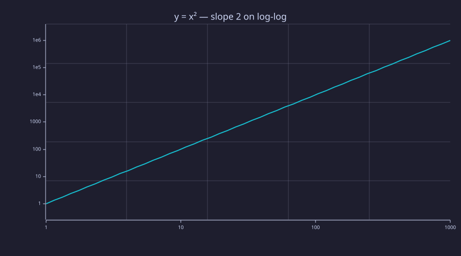
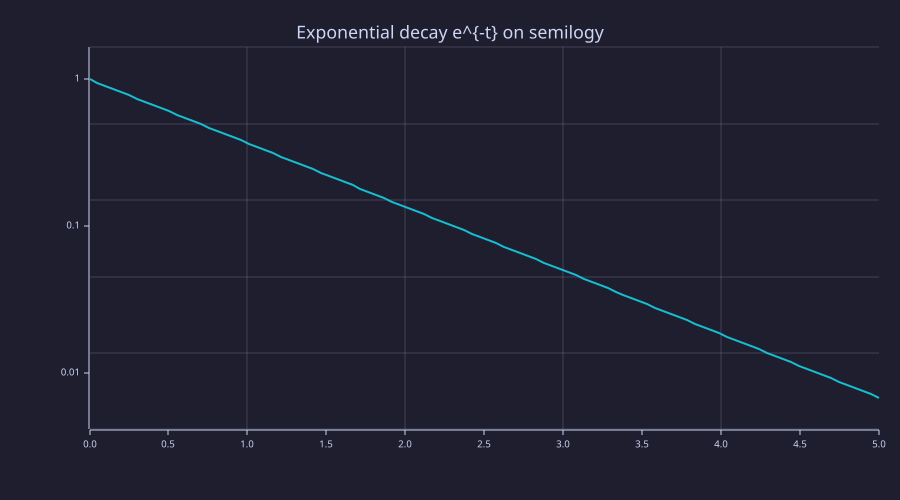
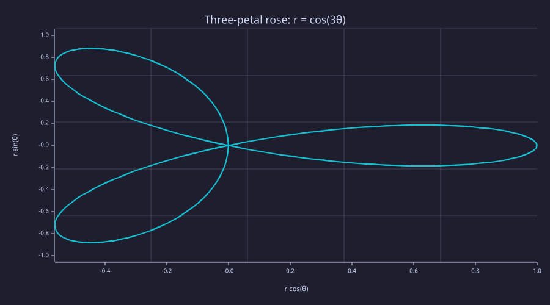
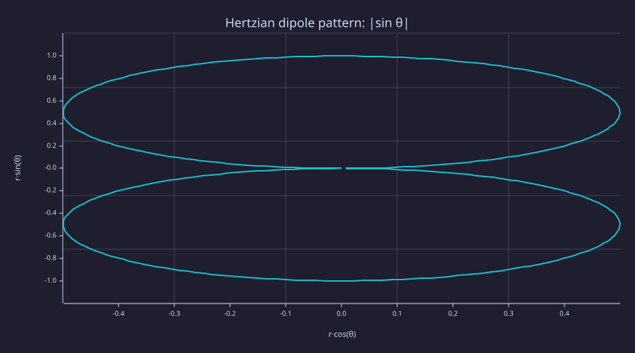

<!-- Generated by rustlab-notebook — do not edit directly. -->

# Log-Axis and Polar Plots

`loglog`, `semilogx`, `semilogy`, and `polar` cover the plots where
linear axes obscure the structure. The three log plots keep the data
in real units and draw a logarithmic axis with decade ticks. `polar`
transforms to Cartesian `(r·cos θ, r·sin θ)` before `plot`. Straight
lines on power-law data and closed shapes on polar data are the
shapes the curriculum needs. `polar` has no radial grid.

## Power laws on loglog

```rustlab
clf
x = logspace(0, 3, 50);
y = x .^ 2;
loglog(x, y);
title("y = x² — slope 2 on log-log");
```

<!-- rustlab:output-start -->


<!-- rustlab:output-end -->

A power law `y = x^a` plots as a straight line of slope `a` on log-log
axes. Decade ticks are labelled with the real `x` and `y`; the slope-2
line confirms the relationship.

`loglog` requires both `x` and `y` to be **strictly positive** —
negatives or zeros produce a clear error rather than NaN-ing through
the plot.

## Exponential decay on semilogy

```rustlab
clf
t = linspace(0, 5, 100);
y = exp(-1 * t);
semilogy(t, y);
title("Exponential decay e^{-t} on semilogy");
```

<!-- rustlab:output-start -->


<!-- rustlab:output-end -->

`semilogy` draws a logarithmic y-axis. Exponential decay shows up
as a straight line of slope `-log10(e) ≈ -0.434` per unit `t`
(the slope is in decades).

## Bode-style frequency response

`semilogx` is the canonical filter-design view: log-spaced frequencies
on the x-axis, linear (often dB) magnitude on the y-axis. Combine it
with `freqz` and `mag2db` — see `filter_analysis.md`.

## Polar — the three-petal rose

`polar(theta, r)` plots the curve in polar coordinates by transforming
to Cartesian: `(r·cos θ, r·sin θ)`. The classic textbook rose curve
`r = cos(3θ)` has three petals — for odd `k`, `cos(kθ)` traces exactly
`k` petals, and the negative-`r` lobes reflect through the origin (which
the Cartesian pre-transform handles directly):

```rustlab
clf
theta = linspace(0, 2*pi, 360);
r = cos(3 * theta);
polar(theta, r);
title("Three-petal rose: r = cos(3θ)");
```

<!-- rustlab:output-start -->


<!-- rustlab:output-end -->

## Hertzian dipole radiation pattern

The far-field radiation pattern of a Hertzian dipole is `|sin θ|` —
the canonical antenna-pattern textbook example:

```rustlab
clf
theta = linspace(-pi, pi, 360);
r = abs(sin(theta));
polar(theta, r);
title("Hertzian dipole pattern: |sin θ|");
```

<!-- rustlab:output-start -->


<!-- rustlab:output-end -->

Two lobes along the broadside direction, nulls along the dipole axis.

## Axes

`loglog`, `semilogx`, and `semilogy` keep the data in real units and
draw a logarithmic axis: decade ticks are labelled with the real
values (`1`, `10`, `100`), not with `log10` of those values. `polar`
is a Cartesian pre-transform, `(r·cos θ, r·sin θ)`, so the plot has
no radial grid.

## Cheat sheet

| Form                                   | Axes                           | Notes                                       |
|----------------------------------------|--------------------------------|---------------------------------------------|
| `loglog(x, y [, opts])`                | both logarithmic               | both x and y must be > 0                    |
| `semilogx(x, y [, opts])`              | x logarithmic, y linear        | x must be > 0                               |
| `semilogy(x, y [, opts])`              | x linear, y logarithmic        | y must be > 0                               |
| `polar(theta, r [, opts])`             | `(r·cos θ, r·sin θ)`           | theta in radians, both real-valued          |

All four accept the same option syntax as `plot()` — color, label,
style, title — and honour `hold on` for overlay with other plot kinds.
