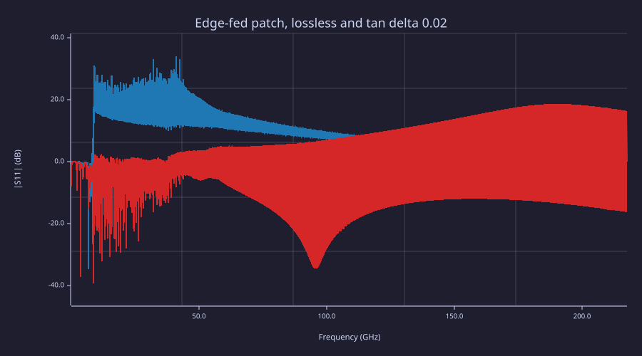

<!-- Generated by rustlab-notebook — do not edit directly. -->

# A patch antenna on a finite ground

The patch and its ground are metal sheets on a 1.6 mm substrate of $\varepsilon_r = 4.4$. Air surrounds that board, and CPML sits on all six faces of the mesh. The near-to-far box is in the air, not on the ground, so the pattern is the finite-ground pattern. There is no image theory.

The mesh is 2 mm in the plane and 0.8 mm through the substrate. Vertical air is 20 mm. A 10 mm gap above the patch puts the box in the reactive field and the pattern integral reads about 2% high; that case is a release diagnostic, not this notebook. The feed is a 50 $\Omega$ series port on the first metal node of the centre row.

The port voltage has died by 8,000 steps. The field on the near-to-far box is slower: at 8,000 steps its tail is $1.9\times 10^{-3}$ of the peak, and at 16,000 steps it is under $10^{-3}$. The run is 16,000 steps so `fdtd_farfield` can keep the pulse check.

The lossy rerun builds a new grid with $\sigma = 2\pi f_0 \varepsilon_r \varepsilon_0 \tan\delta$ at $\tan\delta = 0.02$. Nothing is reset. Directivity should stay put. Gain should fall by about $10\log_{10}\eta$, with $\eta$ near one half.

The script stops if a gate misses. The numbers it prints are the measurement.

```rustlab
# Patch antenna on a finite ground, floating in air.
# Demonstrates: fdtd_media, fdtd_pec, fdtd_cpml, fdtd_port, fdtd_s11,
# fdtd_ntff, fdtd_farfield. The lossy rerun rebuilds the grid.
#
# 2 mm lesson mesh. The 1 mm comparison with the Phase 4 reference is a
# release test, not this script. Vertical air is 20 mm so the near-to-far
# box is out of the reactive field above the patch. The feed is the edge
# feed: the first metal node of the centre row, a 50 ohm series port.

c0 = 299792458;
mu0 = 1.25663706212e-6;
eps0 = 1 / (mu0 * c0 * c0);
eps_r = 4.4;
h = 1.6e-3;
f0 = 2.4e9;
tand = 0.02;

W = c0 / (2 * f0) * sqrt(2 / (eps_r + 1));
ee = (eps_r + 1) / 2 + (eps_r - 1) / 2 / sqrt(1 + 12 * h / W);
dL = 0.412 * h * (ee + 0.3) * (W / h + 0.264) / ((ee - 0.258) * (W / h + 0.8));
L = c0 / (2 * f0 * sqrt(ee)) - 2 * dL;
fprintf("design  L = %.2f mm   W = %.2f mm   eps_eff = %.4f   dL = %.3f mm\n", ...
    L * 1e3, W * 1e3, ee, dL * 1e3);

function sim = patch_sim(sigma, L, W, f0, eps_r)
    dx = 2e-3;
    dy = 2e-3;
    nsub = 2;
    dz = 1.6e-3 / nsub;
    gpad = 16e-3;
    air_xy = 10e-3;
    air_z = 20e-3;
    npml = 8;
    margin = 2;
    ngx = 2 * round((L / 2 + gpad) / dx);
    ngy = 2 * round((W / 2 + gpad) / dy);
    nax = round(air_xy / dx);
    nay = round(air_xy / dy);
    naz = round(air_z / dz);
    nx = ngx + 2 * (npml + margin + nax);
    ny = ngy + 2 * (npml + margin + nay);
    nz = nsub + 2 * (npml + margin + naz);
    jg0 = npml + margin + nax;
    ig0 = npml + margin + nay;
    kg = npml + margin + naz;

    sim = fdtd3d(nx, ny, nz, dx, dy, dz);
    eps = ones3(ny, nx, nz);
    eps(ig0 + 1:ig0 + ngy, jg0 + 1:jg0 + ngx, kg + 1:kg + nsub) = eps_r;
    sig = zeros3(ny, nx, nz);
    if sigma > 0
        sig(ig0 + 1:ig0 + ngy, jg0 + 1:jg0 + ngx, kg + 1:kg + nsub) = sigma;
    end
    fdtd_media(sim, eps, 1, sig);
    fdtd_cpml(sim, npml);

    xv = (0:nx - 1) * dx;
    yv = (0:ny - 1) * dy;
    [X, Y] = meshgrid(xv, yv);
    ground = zeros(ny, nx);
    ground(ig0 + 1:ig0 + ngy + 1, jg0 + 1:jg0 + ngx + 1) = 1;
    fdtd_pec(sim, "z", kg + 1, ground);
    px = nx / 2 * dx - L / 2;
    py = ny / 2 * dy - W / 2;
    patch = rect_mask(X, Y, px, py, L, W);
    fdtd_pec(sim, "z", kg + nsub + 1, patch);

    cols = find(sum(patch, 1) > 0);
    rows = find(sum(patch, 2) > 0);
    span_y = rows(end) - rows(1);
    if span_y != 2 * round(span_y / 2)
        error("patch width is an odd number of cells, so the feed is off the mirror plane");
    end
    iy = round((py + W / 2) / dy) + 1;
    if iy != (rows(1) + rows(end)) / 2
        error("feed row is not the mirror plane of the patch");
    end
    ix = find(patch(iy, :) > 0);
    ix = ix(1);
    tau = 1 / (2 * f0);
    fdtd_port(sim, "ez", iy, ix, kg + 1:kg + nsub, 50, "modulated", 4 * tau, tau, f0);
    fdtd_ntff(sim, 2.34e9:0.02e9:2.40e9, "margin", margin);
end

function s = dip_of(sim)
    rec = fdtd_record(sim);
    s = fdtd_s11(rec.V(:, 1), rec.I(:, 1), rec.dt, 50, "nfft", 8 * rec.steps);
end

sigma = 2 * pi * f0 * eps_r * eps0 * tand;
lossless = patch_sim(0, L, W, f0, eps_r);
out = fdtd_run(lossless, 16000);
fprintf("lossless  %.1f s   %.1f Mcell/s   %d cells\n", out.seconds, out.cell_rate / 1e6, ...
    fdtd_info(lossless).nx * fdtd_info(lossless).ny * fdtd_info(lossless).nz);
rec = fdtd_record(lossless);
nv = rec.steps;
last = round(0.9 * nv);
tv = max(abs(rec.V(last:end, 1))) / max(abs(rec.V(:, 1)));
ti = max(abs(rec.I(last:end, 1))) / max(abs(rec.I(:, 1)));
fprintf("port tail  |V| %.2e   |I| %.2e\n", tv, ti);
if tv > 1e-3 || ti > 1e-3
    error(sprintf("port tail |V| %.2e |I| %.2e", tv, ti));
end
s0 = dip_of(lossless);
f = s0.frequencies;
a = abs(sij(s0, 1, 1));
band = find(and(f > 1.8e9, f < 3.2e9));
k = argmin(a(band));
f_dip = f(band(k));
a_dip = a(band(k));
wide = find(and(f > 1.5e9, f < 3.5e9));
a_max = max(a(wide));
fprintf("dip %.4f GHz   |S11| %.3f (%.1f dB)   max |S11| %.4f\n", ...
    f_dip / 1e9, a_dip, 20 * log10(a_dip), a_max);

# The staircased metal is the node span. One extra cell is the Yee edge
# sitting half a cell outside each end, which is what the TL check uses.
dx = 2e-3;
Lm = 28e-3;
Wm = 36e-3;
w_eff = Wm + dx;
ee_m = (eps_r + 1) / 2 + (eps_r - 1) / 2 / sqrt(1 + 12 * h / w_eff);
dL_m = 0.412 * h * (ee_m + 0.3) * (w_eff / h + 0.264) / ((ee_m - 0.258) * (w_eff / h + 0.8));
f_model = c0 / (2 * (Lm + dx + 2 * dL_m) * sqrt(ee_m));
fprintf("TL+cell %.4f GHz   err %+.2f %%\n", f_model / 1e9, (f_dip / f_model - 1) * 100);

if abs(f_dip / f0 - 1) > 0.05
    error(sprintf("dip %.4f GHz is more than 5%% from 2.4 GHz", f_dip / 1e9));
end
if abs(f_dip / f_model - 1) > 0.015
    error(sprintf("dip is %.2f%% from the staircased TL model", (f_dip / f_model - 1) * 100));
end
if a_max > 1
    error(sprintf("max |S11| = %.4f on a decayed record", a_max));
end

th = (0:3:180) * pi / 180;
ph = (0:3:357) * pi / 180;
pat = fdtd_farfield(lossless, th, ph);
q = argmin(abs(pat.freq - f_dip));
D = squeeze(pat.directivity(q, :, :));
U = squeeze(pat.U(q, :, :));
dth = 3 * pi / 180;
dph = 3 * pi / 180;
wth = th * 0 + dth;
wth(1) = wth(1) / 2;
wth(end) = wth(end) / 2;
wcol = (sin(th) .* wth)';
psph = sum(sum(U .* (wcol * ones(1, length(ph))))) * dph;
bal = (pat.paccepted(q) - pat.prad(q)) / pat.paccepted(q);
d0 = pat.directivity_dBi(q, 1, 1);
g0 = pat.gain_dBi(q, 1, 1);
gr0 = pat.realized_gain_dBi(q, 1, 1);
fb = 10 * log10(D(1, 1) / D(end, 1));
fprintf("D %.2f dBi   G %.2f   Gr %.2f   F/B %.1f dB   Psph/Pflux %.4f   balance %.2e\n", ...
    d0, g0, gr0, fb, psph / pat.prad(q), bal);

[mx, imax] = max(D(:));
[ti, pj] = ind2sub(size(D), imax);
if ti != 1
    error("broadside is not the directivity peak");
end
if d0 < 6 || d0 > 8
    error(sprintf("broadside directivity %.2f dBi is outside 6 to 8", d0));
end
if fb < 10
    error(sprintf("front/back %.1f dB is under 10", fb));
end
if abs(psph / pat.prad(q) - 1) > 5e-3
    error(sprintf("pattern integral is %.2f%% off the flux", (psph / pat.prad(q) - 1) * 100));
end
if abs(bal) > 1e-2
    error(sprintf("power balance %.2e", bal));
end
if abs(g0 - d0) > 0.05
    error(sprintf("lossless gain and directivity differ by %.3f dB", g0 - d0));
end

lossy = patch_sim(sigma, L, W, f0, eps_r);
fdtd_run(lossy, 16000);
s1 = dip_of(lossy);
f1 = s1.frequencies;
a1 = abs(sij(s1, 1, 1));
k1 = argmin(a1(band));
f1_dip = f1(band(k1));
pat1 = fdtd_farfield(lossy, th, ph);
q1 = argmin(abs(pat1.freq - f1_dip));
eta = pat1.prad(q1) / pat1.paccepted(q1);
d1 = pat1.directivity_dBi(q1, 1, 1);
g1 = pat1.gain_dBi(q1, 1, 1);
fprintf("lossy    dip %.4f GHz   |S11| %.3f   eta %.3f   D %.2f dBi   G %.2f dBi\n", ...
    f1_dip / 1e9, a1(band(k1)), eta, d1, g1);
if abs(f1_dip / f_dip - 1) > 0.005
    error("loss moved the dip");
end
if a1(band(k1)) >= a_dip
    error("loss did not deepen the match");
end
if eta < 0.40 || eta > 0.60
    error(sprintf("efficiency %.3f is outside 0.40 to 0.60", eta));
end
if abs(d1 - d0) > 0.05
    error(sprintf("loss moved directivity by %.3f dB", d1 - d0));
end
if abs(g1 - (d1 + 10 * log10(eta))) > 0.01
    error("gain is not directivity plus 10 log10(efficiency)");
end

clf;
plot(f / 1e9, 20 * log10(max(a, 1e-6)), "b", f1 / 1e9, 20 * log10(max(a1, 1e-6)), "r");
xlabel("Frequency (GHz)");
ylabel("|S11| (dB)");
title("Edge-fed patch, lossless and tan delta 0.02");
```

<!-- rustlab:output-start -->
```text
design  L = 29.42 mm   W = 38.01 mm   eps_eff = 4.0857   dL = 0.739 mm
lossless  44.8 s   101.7 Mcell/s   285120 cells
port tail  |V| 3.20e-06   |I| 1.30e-06
dip 2.3749 GHz   |S11| 0.610 (-4.3 dB)   max |S11| 0.9978
TL+cell 2.3559 GHz   err +0.81 %
D 6.94 dBi   G 6.94   Gr 4.91   F/B 13.0 dB   Psph/Pflux 1.0003   balance 1.04e-03
lossy    dip 2.3749 GHz   |S11| 0.339   eta 0.489   D 6.94 dBi   G 3.83 dBi
```



<!-- rustlab:output-end -->
