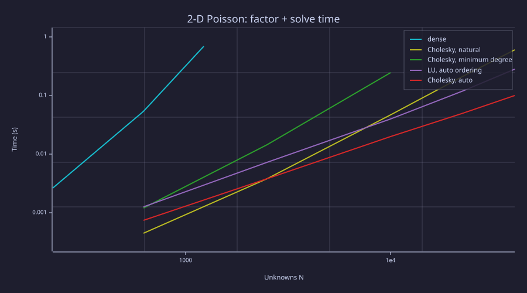
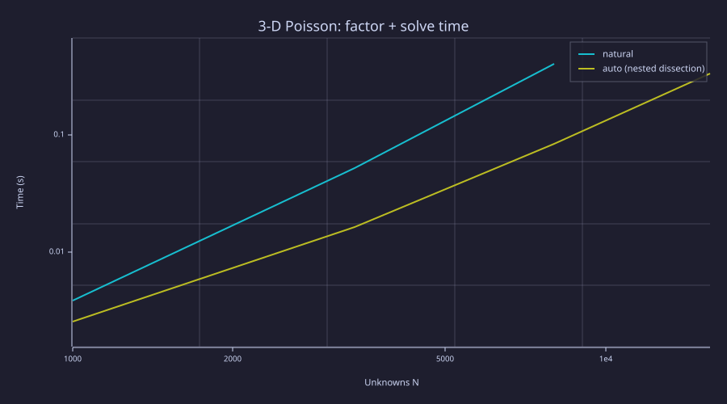

<!-- Generated by rustlab-notebook — do not edit directly. -->

# Sparse vs Dense — The Scaling Story

Sparse direct solvers (Cholesky and LU, hand-rolled in pure Rust) keep
a grid-shaped system sparse from assembly to answer. A dense solve
stores all $N^2$ entries and does $O(N^3)$ work, so it falls off a cliff
within a few thousand unknowns. How far the sparse solvers go depends on
the **elimination order**: the same matrix factored in a different
order can fill in several times more.

Every number below is measured when this notebook runs (release build,
`tic` / `toc`), so the timings are those of the machine that rendered
it. The sizes are kept small enough to render in a few seconds.

## Dense vs sparse on a 2-D Poisson problem

The 5-point Laplacian on an $n \times n$ grid has $N = n^2$ unknowns.
`A \ b` on the sparse matrix picks sparse Cholesky and a fill-reducing
ordering by itself. `full(A) \ b` does the same solve densely:

```rustlab
n_dense = [15, 25, 35];
t_dense = zeros(1, 3);  t_sp_small = zeros(1, 3);
for k = 1:3
  n = n_dense(k);
  A = -1 * laplacian_2d(n, n);  b = ones(n * n, 1);  D = full(A);
  tic; x = D \ b; t_dense(k) = toc;
  tic; y = A \ b; t_sp_small(k) = toc;
end
print(n_dense .^ 2)          % unknowns
print(t_dense)               % dense, seconds
print(t_sp_small)            % sparse, seconds
```

<!-- rustlab:output-start -->
```text
[1×3]  225.000000  625.000000  1225.000000
Matrix(1x3)
  [0.002625, 0.053010, 0.680092]
Matrix(1x3)
  [0.000297, 0.000815, 0.001695]
```

<!-- rustlab:output-end -->

At 35×35 (1225 unknowns) the dense solve already takes a large
fraction of a second and the sparse one about a millisecond; each step
up in grid size widens the gap, because dense work grows as $N^3$.
A 100×100 grid would need a dense matrix of
$10^4 \times 10^4 \times 16$ bytes = **1.6 GB**.

## Orderings on larger 2-D grids

Past the dense range, the interesting comparison is between orderings
of the same sparse Cholesky:

- **auto** (`A \ b`): nested dissection or the natural order, whichever
  predicts the smaller factor. On a grid this is nested dissection,
  which cuts the grid in half along a line, orders each half
  recursively, and puts the cut last.
- **natural** (`"identity"`): the grid's column-major numbering, a band
  of width $n$.
- **minimum degree** (`"amd"`): the basic variant; its $O(N^2)$ pivot
  search makes it slow on large grids, so it stops at 100×100 here.
- **LU** (`"lu"`): the non-symmetric path, also with the automatic
  ordering, for comparison.

```rustlab
n_grid = [25, 50, 100, 150, 200];
N = n_grid .^ 2;
t_auto = zeros(1, 5);  t_nat = zeros(1, 5);  t_lu = zeros(1, 5);
for k = 1:5
  n = n_grid(k);
  A = -1 * laplacian_2d(n, n);  b = ones(n * n, 1);
  tic; x = A \ b; t_auto(k) = toc;
  tic; x = spsolve(A, b, "cholesky", "identity"); t_nat(k) = toc;
  tic; x = spsolve(A, b, "lu"); t_lu(k) = toc;
end
n_amd = [25, 50, 100];
t_amd = zeros(1, 3);
for k = 1:3
  n = n_amd(k);
  A = -1 * laplacian_2d(n, n);  b = ones(n * n, 1);
  tic; x = spsolve(A, b, "cholesky", "amd"); t_amd(k) = toc;
end
print(t_auto)
print(t_nat)
print(t_lu)
print(t_amd)
```

<!-- rustlab:output-start -->
```text
Matrix(1x5)
  [0.000738, 0.003798, 0.019525, 0.049205, 0.099118]
Matrix(1x5)
  [0.000445, 0.003789, 0.046357, 0.210770, 0.601419]
Matrix(1x5)
  [0.001258, 0.007096, 0.039357, 0.119538, 0.276030]
Matrix(1x3)
  [0.001184, 0.014343, 0.245105]
```

<!-- rustlab:output-end -->

```rustlab
clf
hold on
loglog(n_dense .^ 2, t_dense, "dense");
loglog(N, t_nat, "Cholesky, natural");
loglog(n_amd .^ 2, t_amd, "Cholesky, minimum degree");
loglog(N, t_lu, "LU, auto ordering");
loglog(N, t_auto, "Cholesky, auto");
hold off
title("2-D Poisson: factor + solve time")
xlabel("Unknowns N")
ylabel("Time (s)")
legend("dense", "Cholesky, natural", "Cholesky, minimum degree", "LU, auto ordering", "Cholesky, auto")
```

<!-- rustlab:output-start -->


<!-- rustlab:output-end -->

The dense curve is the steepest. Among the sparse curves, the
natural order grows as $N^2$ (a band of width $\sqrt{N}$, $N$ rows,
$\sqrt{N}$ work per entry), and nested dissection grows close to
$N^{1.5}$, so the gap widens with the grid.

## Why: the size of the factor

Time follows the number of entries in the Cholesky factor. Printing a
factor handle shows it:

```rustlab
A = -1 * laplacian_2d(100, 100);
print(chol(A, "identity"))   % natural order
print(chol(A, "amd"))        % minimum degree
print(chol(A))               % auto: nested dissection here
```

<!-- rustlab:output-start -->
```text
<chol factor 10000×10000, real, nnz=1000099>
<chol factor 10000×10000, real, nnz=1917475>
<chol factor 10000×10000, real, nnz=266896>
```

<!-- rustlab:output-end -->

For the 100×100 grid (10 000 unknowns) nested dissection's factor is
several times smaller than the natural order's, and the basic
minimum-degree factor is the largest of the three; the ratio grows with
the grid (at 200×200: 1.26 M entries for nested dissection, 8.0 M
natural, 15.7 M minimum degree). Memory follows the same ratio: each
entry costs 8 bytes plus a row index in the real factor. The dense
200×200 matrix would need 25 GB.

## 3-D grids make the ordering matter more

On an $n \times n \times n$ grid the natural order is a band of width
$n^2$, so its factor grows much faster:

```rustlab
n3 = [10, 15, 20, 25];
t3_auto = zeros(1, 4);
for k = 1:4
  n = n3(k);
  A = -1 * laplacian_3d(n, n, n);  b = ones(n ^ 3, 1);
  tic; x = A \ b; t3_auto(k) = toc;
end
n3_nat = [10, 15, 20];
t3_nat = zeros(1, 3);
for k = 1:3
  n = n3_nat(k);
  A = -1 * laplacian_3d(n, n, n);  b = ones(n ^ 3, 1);
  tic; x = spsolve(A, b, "cholesky", "identity"); t3_nat(k) = toc;
end
print(t3_auto)
print(t3_nat)
print(t3_nat(3) / t3_auto(3))   % speedup of auto over natural at 20³
```

<!-- rustlab:output-start -->
```text
Matrix(1x4)
  [0.002592, 0.016500, 0.084025, 0.331287]
Matrix(1x3)
  [0.003860, 0.052104, 0.396975]
4.7244690340732705
```

<!-- rustlab:output-end -->

```rustlab
clf
hold on
loglog(n3_nat .^ 3, t3_nat, "natural");
loglog(n3 .^ 3, t3_auto, "auto (nested dissection)");
hold off
title("3-D Poisson: factor + solve time")
xlabel("Unknowns N")
ylabel("Time (s)")
legend("natural", "auto (nested dissection)")
```

<!-- rustlab:output-start -->


<!-- rustlab:output-end -->

This is the regime of `rustlab_em` Lesson 18's 41³ capacitor: 27.4 s
with the natural-order LU used before 0.3.85, 1.3 s with the automatic
path (see `dev/plans/sparse_spd_solve.md`).

## Real vs complex

The factorization uses a real-only `f64` solver whenever every entry
of `A` has a zero imaginary part (below $10^{-12}$); complex
factorization does about 4× the arithmetic. A complex right-hand side
does not force the complex path — a real `A` solves its real and
imaginary parts separately:

```rustlab
A = -1 * laplacian_2d(150, 150);  b = ones(22500, 1);
Az = A + 1e-3j * speye(22500);           % a small complex shift
tic; x = A \ (b + 1j * b); t_real = toc;
tic; z = Az \ (b + 1j * b); t_cplx = toc;
print(t_cplx / t_real)                   % complex factor vs real factor
```

<!-- rustlab:output-start -->
```text
2.9484942011485
```

<!-- rustlab:output-end -->

## Reproducing at larger sizes

The Rust benchmark covers sizes too slow for a notebook:

```sh
cargo run --release --example bench_sparse_solve -p rustlab-core
```

It lives at `crates/rustlab-core/examples/bench_sparse_solve.rs`;
`perf/sparse_solve_phase1to4.md` holds the earlier (0.3.x) results.

## Cheat sheet

| Call | What runs |
|---|---|
| `A \ b`, `spsolve(A, b)` | Cholesky if Hermitian positive definite (also after removing `pin_dirichlet` rows), else LU; automatic ordering |
| `spsolve(A, b, mode, "identity")` | natural order — best on a 1-D band, poor on 2-D / 3-D grids |
| `spsolve(A, b, mode, "nd")` | nested dissection |
| `spsolve(A, b, mode, "amd")` | basic minimum degree; slow past about $10^4$ unknowns |
| `full(A) \ b` | dense; $O(N^3)$, only for small systems |

The headline: **sparse plus a good elimination order** is what makes
grid problems tractable. Dense solves stop being practical at a few
thousand unknowns; with nested dissection the sparse solver handles a
200×200 grid in about a tenth of a second.
