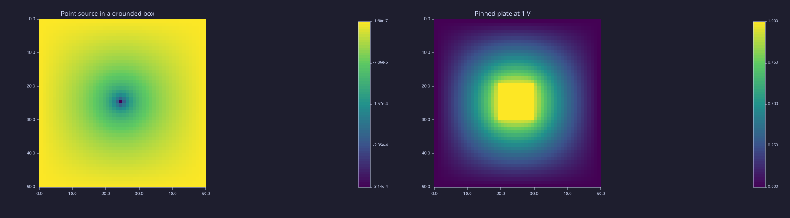
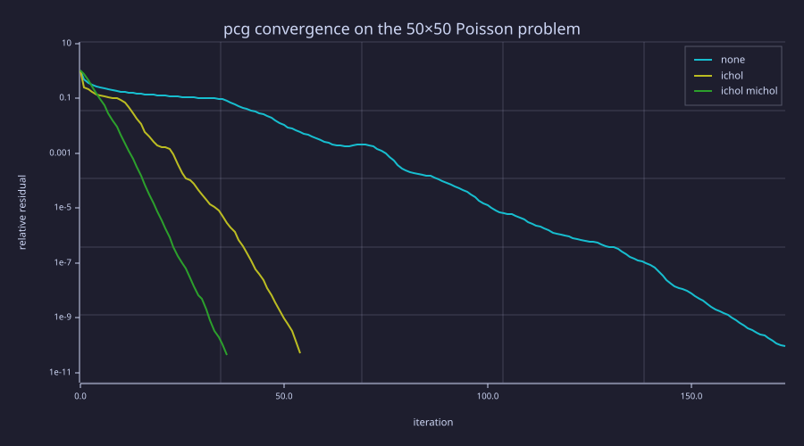

<!-- Generated by rustlab-notebook — do not edit directly. -->

# Sparse Solves — `\`, `spsolve`, and `pcg`

`A \ b` with a sparse square `A`, and `spsolve(A, b)`, solve `A·x = b`
with hand-rolled sparse direct methods: up-looking sparse Cholesky for
Hermitian-positive-definite systems, and Gilbert-Peierls sparse LU with
partial pivoting for everything else. A fill-reducing ordering is
chosen for each matrix (nested dissection or the natural order,
whichever predicts the smaller factor). The automatic choice follows
MATLAB's sparse `\`, so the script-level call stays simple.

Before sparse factorization, a 100×100 Lesson-05 grid ($10^4$ unknowns)
was densified (about 800 MB) and solved in cubic time. Sparse
factorization stays sparse end-to-end and handles grids an order of
magnitude larger.

## A Hermitian-positive-definite assembly

The 5-point Laplacian stencil with homogeneous Dirichlet boundaries is
the canonical SPD assembly. `laplacian_2d` returns $+\nabla^2$, so for
an SPD Poisson solve we want $-L$:

```rustlab
nx = 50;  ny = 50;
dx = 0.02; dy = 0.02;
L  = laplacian_2d(nx, ny, dx, dy);
A  = -1 * L;             % SPD: -∇² with homogeneous Dirichlet
n  = nx * ny;
print(issparse(A))       % → 1
print(nnz(A))            % → ~12k (5-point stencil, modulo boundary trims)
```

<!-- rustlab:output-start -->
```text
1
12300
```

<!-- rustlab:output-end -->

The matrix has $n = 2500$ unknowns and roughly 12 000 non-zeros — a
0.2 % density. Densified, it's a 2500 × 2500 complex matrix taking
about 100 MB. Sparse, it fits in well under 1 MB.

## Default dispatch picks the right path

`A \ b` is `spsolve(A, b)` in its default `"auto"` mode. `spsolve` takes
an optional third argument, `"auto"`, `"cholesky"`, or `"lu"`. With
`"auto"`:

1. If `A` is Hermitian (mirrored entries match) with a real positive
   diagonal, factor with sparse Cholesky.
2. Otherwise, if some rows hold only a diagonal entry (the rows
   `pin_dirichlet` writes) and the rest of the matrix is Hermitian, set
   those unknowns directly and Cholesky-factor the rest (next section).
3. Otherwise, or if a Cholesky pivot is not positive, factor with
   sparse LU.

The solution is an $n \times 1$ column, the shape MATLAB returns.

```rustlab
% Centred point source.
rho = zeros(ny, nx);
rho(ny/2, nx/2) = 1.0;
b   = -1 * rho(:);

% Default dispatch: -L is SPD, so auto picks Cholesky.
v_auto = A \ b;
print(size(v_auto))              % → [2500, 1]
print(norm(A * v_auto - b))      % → roundoff (~1e-14)
```

<!-- rustlab:output-start -->
```text
[1×2]  2500.000000  1.000000
0.000000000000006383716891443751
```

<!-- rustlab:output-end -->

## Pinned boundary values

`pin_dirichlet` replaces each pinned row with a scaled identity row and
leaves the column alone, so the pinned matrix is no longer symmetric.
`\` notices that those rows fix their unknowns outright
($x_k = b_k / A_{kk}$), moves their columns to the right-hand side, and
the block that is left is symmetric again, so it still gets Cholesky.
MATLAB's sparse LU removes these "singleton" rows the same way.

```rustlab
plate = zeros(ny, nx);  plate(20:30, 20:30) = 1;     % a conductor at 1 V
box   = ones(ny, nx);   box(2:ny-1, 2:nx-1) = 0;     % grounded walls
[P, q] = pin_dirichlet(A, zeros(n, 1), plate, 1.0);
[P, q] = pin_dirichlet(P, q, box, 0.0);
V_pin = P \ q;
print(max(abs(V_pin(find(plate(:))) - 1)))   % → 0  (pinned values exact)
print(norm(P * V_pin - q) / norm(q))          % → ~1e-16
```

<!-- rustlab:output-start -->
```text
0
0.00000000000000040717991695444353
```

<!-- rustlab:output-end -->

## Forcing a path

When you know in advance which factorization you want — to assert the
structure of an assembly, or to compare — pass the mode explicitly.

```rustlab
% Force the sparse Cholesky path (errors unless Hermitian positive definite).
v_chol = spsolve(A, b, "cholesky");

% Force the sparse LU path. LU works on any square non-singular matrix,
% even when the SPD check would have routed through Cholesky.
v_lu = spsolve(A, b, "lu");

print(norm(v_auto - v_chol))    % → ~0  (auto and forced agree exactly)
print(norm(v_auto - v_lu))      % → roundoff (different fp accumulation)
```

<!-- rustlab:output-start -->
```text
0
0.00000000000000001744300194097451
```

<!-- rustlab:output-end -->

`"cholesky"` on a matrix that is not Hermitian (after removing pinned
rows) is an error, not a silent wrong answer.

## Sparse LU on indefinite matrices

A symmetric matrix can still be indefinite. The classic small example
is `[[1, 2], [2, 1]]`, eigenvalues 3 and -1.

`auto` tries Cholesky, meets a negative pivot, and falls back to sparse
LU, which doesn't care about positive-definiteness:

```rustlab
S = sparse([1, 2; 2, 1]);
x = S \ [1; 1];
print(x)        % → [0.333; 0.333]   (LU path, 2×1)
```

<!-- rustlab:output-start -->
```text
Matrix(2x1)
  [0.333333]
  [0.333333]
```

<!-- rustlab:output-end -->

A larger indefinite assembly — a shifted Helmholtz-like operator
$-\nabla^2 + \alpha I$ with $\alpha$ large enough that the eigenvalues
straddle zero — solves the same way:

```rustlab
nx_i = 30; ny_i = 30;
L_i = laplacian_2d(nx_i, ny_i);
B = -1 * L_i - 0.5 * speye(nx_i * ny_i);   % indefinite
v_i = B \ ones(nx_i * ny_i, 1);             % auto → LU
print(norm(B * v_i - ones(nx_i * ny_i, 1)))
```

<!-- rustlab:output-start -->
```text
0.0000000000069495105666492735
```

<!-- rustlab:output-end -->

Forcing `"cholesky"` on `B` gives a clear "not Hermitian positive
definite" error — useful as an assertion during development.

## Orderings

The order in which unknowns are eliminated decides how much the factor
fills in. The fourth argument of `spsolve` (and the second of `lu`)
picks it: `"auto"` (default), `"identity"` / `"natural"`, `"nd"`
(nested dissection), or `"amd"` (basic minimum degree). The same names
select the permutation of `[R, p, P] = chol(A, ordering)`, so `nnz(R)`
shows the size of each factor:

```rustlab
[R_nat, p, P] = chol(A, "natural");
[R_nd,  p, P] = chol(A, "nd");
[R_amd, p, P] = chol(A, "amd");
[R_auto, p, P] = chol(A);     % "auto": the smaller of nested dissection and natural
print(nnz(R_nat))     % natural order: a band of width ny
print(nnz(R_nd))      % nested dissection: the smallest of the three
print(nnz(R_amd))
print(nnz(R_auto))
```

<!-- rustlab:output-start -->
```text
125049
52993
229975
52993
```

<!-- rustlab:output-end -->

On a 1-D band the natural order has no fill and `"auto"` keeps it; on
2-D and 3-D grids nested dissection wins, and by more as the grid grows
(see the `sparse_scaling` notebook).

## The Cholesky factor — MATLAB's `chol`

`R = chol(A)` returns the sparse upper factor with $R^H R = A$, in the
matrix's own order, as MATLAB does. Asking for a third output adds a
fill-reducing permutation $P$ with $R^H R = P^T A P$, and that factor is
smaller (the natural order is a band of width `ny`). `R \ b` is a
triangular solve, so two of them and two permutations solve the system:

```rustlab
R0 = chol(A);
[R, p, P] = chol(A);
print(p)                                     % → 0: positive definite
print(nnz(R0))                               % natural order
print(nnz(R))                                % with P
print(norm(full(R' * R - P' * A * P)))       % → roundoff (A's entries are ~1e4)
x = P * (R \ (R' \ (P' * b)));
print(norm(x - A \ b) / norm(A \ b))         % → ~1e-15
```

<!-- rustlab:output-start -->
```text
0
125049
52993
0.000000000016437768377715555
0.0000000000000005517231230662504
```

<!-- rustlab:output-end -->

`[R, p] = chol(M)` never errors: on a matrix that is not positive
definite it returns the pivot that failed, and `R` is the first
$p - 1$ rows of the factor. That is MATLAB's test for definiteness:

```rustlab
[R1, p1] = chol(A - 2000 * speye(n));       % shifted so it is indefinite
print(p1)                                    % → the failed pivot, no error
```

<!-- rustlab:output-start -->
```text
105
```

<!-- rustlab:output-end -->

To factor once and solve many right-hand sides, keep a
`decomposition`. It holds the same factor `\` would use, including the
pinned-row reduction:

```rustlab
dA = decomposition(A, "chol");
print(dA.Type)                               % → chol
x1 = dA \ b;
x2 = dA \ (2 * b);                           % no new factorization
print(norm(x2 - 2 * x1))                     % → 0
```

<!-- rustlab:output-start -->
```text
chol
0
```

<!-- rustlab:output-end -->

## Real-vs-complex auto-routing

The factorization inspects the entries of `A` and uses a real-only `f64`
solver when every imaginary part is below $10^{-12}$. Complex
factorization is roughly 4× the work, so this matters in a language
whose numbers are complex by default. A complex right-hand side with a
real `A` is solved as two real solves:

```rustlab
bz = b + 1j * 0.5 * b;
vz = A \ bz;
print(norm(A * vz - bz))     % → roundoff (~1e-14)
```

<!-- rustlab:output-start -->
```text
0.000000000000007137212459190937
```

<!-- rustlab:output-end -->

## Visualising the solutions

```rustlab
clf
subplot(1, 2, 1);
imagesc(reshape(v_auto, ny, nx));
title("Point source in a grounded box")
subplot(1, 2, 2);
imagesc(reshape(V_pin, ny, nx));
title("Pinned plate at 1 V")
```

<!-- rustlab:output-start -->


<!-- rustlab:output-end -->

Left: the potential of a point charge inside a grounded box, peaking at
the source and decaying to zero at the walls. Right: the same box with
a square conductor held at 1 V by `pin_dirichlet`.

## Singular systems are caught at factorization time

```rustlab
% Z = sparse(zeros(3, 3))
% spsolve(Z, [1; 2; 3])    % errors: matrix is singular
```

Both paths report singularity at the offending column (LU through its
pivot test, Cholesky through its positive-pivot test) rather than
silently returning garbage.

## Iterative solves — `pcg` and `ichol`

`\` is a direct solve: it factors $A$ and is accurate to roundoff.
`pcg` (preconditioned conjugate gradients) instead iterates until the
relative residual $\lVert b - Ax \rVert / \lVert b \rVert$ drops below
`tol`, touching $A$ only through products. On large 3-D grids, where
the factor fills in, that is much faster (41³ Poisson: 0.16 s against
5.4 s for `\`, see `docs/sparse_solve.md`). The arguments follow
MATLAB: `pcg(A, b, tol, maxit, M1, M2, x0)`.

A preconditioner $M \approx A$ that is cheap to invert cuts the
iteration count. `ichol(A)` is the incomplete Cholesky factor: $L$
keeps the sparsity pattern of the lower triangle of $A$, so
$L L^H \approx A$, and `pcg` applies $M^{-1} = L^{-H} L^{-1}$ by two
triangular solves.

```rustlab
tol = 1e-10;
[x0, flag0, relres0, it0, res0] = pcg(A, b, tol, 1000);
Lic = ichol(A);
[x1, flag1, relres1, it1, res1] = pcg(A, b, tol, 1000, Lic, Lic');
Lm = ichol(A, struct("michol", "on"));
[x2, flag2, relres2, it2, res2] = pcg(A, b, tol, 1000, Lm, Lm');
fprintf("flag:       %d  %d  %d\n", flag0, flag1, flag2)     % 0 = converged
fprintf("iterations: %d  %d  %d   (none, IC(0), modified IC)\n", it0, it1, it2)
fprintf("difference from A \\ b: %.1e\n", norm(x1 - v_auto) / norm(v_auto))
```

<!-- rustlab:output-start -->
```text
flag:       0  0  0
iterations: 173  54  36   (none, IC(0), modified IC)
difference from A \ b: 2.2e-11
```

<!-- rustlab:output-end -->

Asking for `flag` keeps `pcg` quiet; with one output it prints
MATLAB's "pcg converged at iteration N …" line (or a warning when it
stops early), so check `flag` in scripts. `resvec` holds the residual
norm at every iteration:

```rustlab
clf
semilogy(0:it0, res0 / norm(b));
hold on
semilogy(0:it1, res1 / norm(b));
semilogy(0:it2, res2 / norm(b));
hold off
legend("none", "ichol", "ichol michol")
xlabel("iteration"); ylabel("relative residual")
title("pcg convergence on the 50×50 Poisson problem")
```

<!-- rustlab:output-start -->


<!-- rustlab:output-end -->

`pcg` assumes $A$ is Hermitian positive definite and does not check.
An indefinite matrix usually ends with `flag = 4`, and a `pin_dirichlet`
operator is not symmetric, so `\` is the safe choice for it.

## Background — why hand-rolled

Per project policy (`AGENTS.md` Rule 10) core numerical algorithms in
rustlab are written in pure Rust without large library dependencies.
The factorizations follow Davis, *Direct Methods for Sparse Linear
Systems*, and George & Liu for the ordering:

- Sparse Cholesky: up-looking algorithm (Davis, chapter 4).
- Sparse LU: Gilbert-Peierls with threshold partial pivoting (chapter 6),
  tolerance 0.1.
- Nested dissection: level-set bisection from a pseudo-peripheral node
  (George & Liu, chapter 8); `"auto"` compares its predicted fill with
  the natural order's.
- `pcg`: conjugate gradients with MATLAB's stopping rules and flags;
  `ichol`: left-looking incomplete Cholesky (IC(0), threshold, modified).
- Minimum degree (`"amd"`): the basic variant on the pattern of
  $A + A^T$ (Davis, chapter 7), kept as an option; its O(n²) pivot
  search makes it slow past about $10^4$ unknowns.

See `docs/sparse_solve.md` for the design walkthrough and
`dev/plans/sparse_spd_solve.md` for measurements and planned work
(a faster, supernodal factor kernel).

## Cheat sheet

| Form                                | Path                                                     |
|-------------------------------------|----------------------------------------------------------|
| `A \ b`, `spsolve(A, b)`            | auto: Cholesky; Cholesky after pinned rows; else LU     |
| `spsolve(A, b, "cholesky")`         | Cholesky only; error if not Hermitian positive definite |
| `spsolve(A, b, "lu")`               | sparse LU                                                |
| `spsolve(A, b, mode, "nd")`         | force an ordering (`"identity"`, `"amd"`, `"nd"`)        |
| `dA = decomposition(A)`, `dA \ b`   | factor once, solve many right-hand sides                 |
| `[R, p, P] = chol(A)`               | sparse factor, `R'*R = P'*A*P`; `p > 0` if not SPD       |
| `[x, flag] = pcg(A, b, tol, maxit)` | iterative, accurate to `tol`; SPD `A`                    |
| `L = ichol(A)`, `pcg(..., L, L')`   | incomplete Cholesky preconditioner                       |

Results are $n \times 1$ columns.
