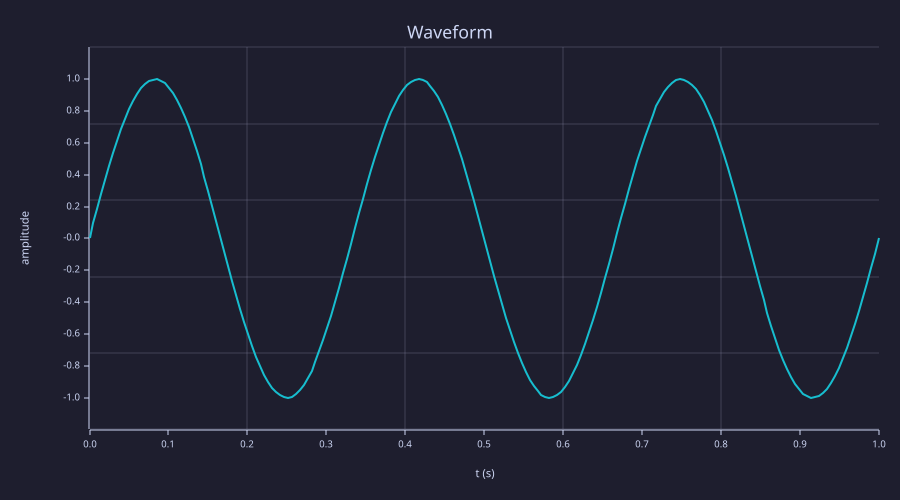

<!-- Generated by rustlab-notebook — do not edit directly. -->

# Controls beside the plot

A `rustlab-widget` fence that sits immediately above a rustlab cell is that
cell's control panel: one card, controls on the left, the plot on the right.
`widgets_demo.md` keeps full-width bars because a heading and a paragraph
sit between its controls and the plot.

%%#c1: the panel sits in the cell, not in the comments column%%

**Amplitude:** `1`

**Waveform:** `sine`

```rustlab
amp = widget("amp");
t = linspace(0, 1, 200);
if widget("shape") == "cosine"
  y = amp * cos(2 * pi * 3 * t);
else
  y = amp * sin(2 * pi * 3 * t);
end
plot(t, y)
title("Waveform")
xlabel("t (s)")
ylabel("amplitude")
```

<!-- rustlab:output-start -->


<!-- rustlab:output-end -->

Open this file with `notebook watch` to drag the controls. A batch HTML
render shows the same panel with the controls disabled at their defaults.
The slider sends its value when the thumb is released (`run = "release"`).
